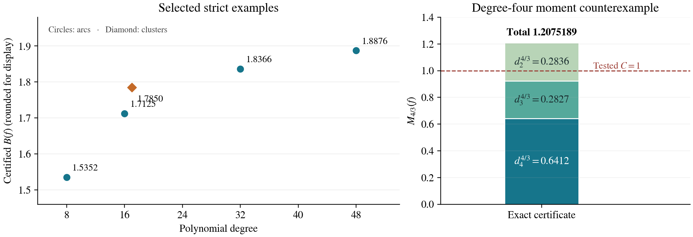
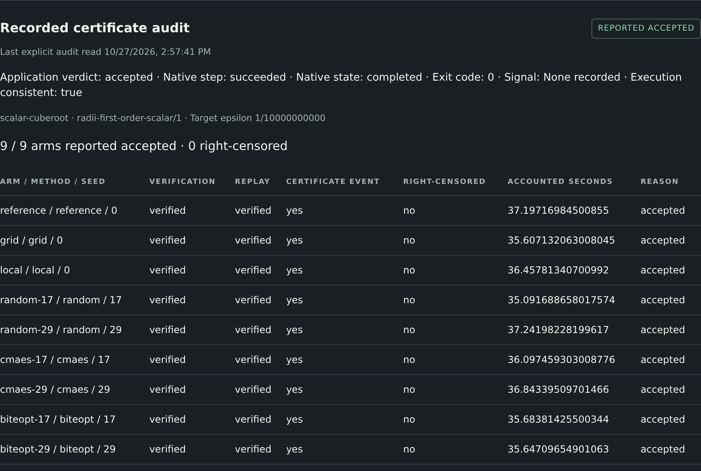
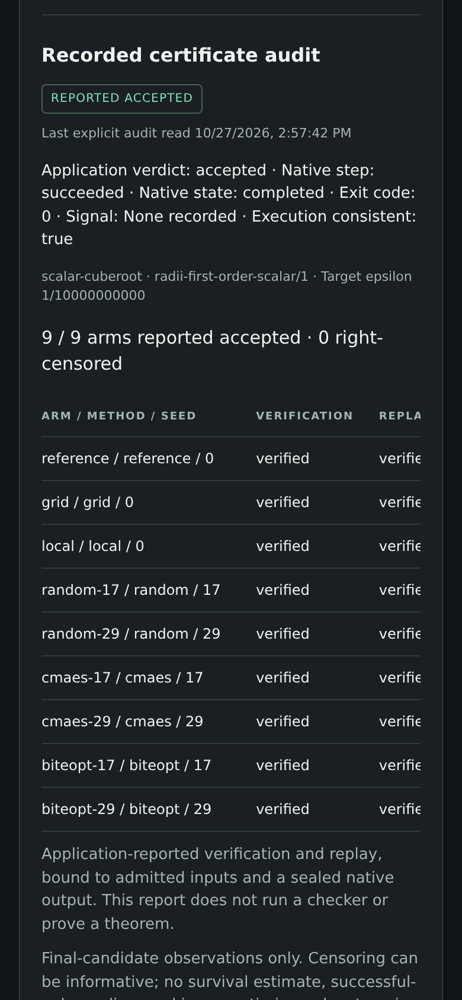

# From Numerical Search to Checkable Mathematics

*A mathematician's guide to the experiment-craft ecosystem.* A typeset
[PDF](mathematicians/mathematicians-guide.pdf) of this guide is built from
this file; [mathematicians/README.md](mathematicians/README.md) says how.

## What this guide lets you do

Use this software to turn a mathematical question into a reproducible
computation: formulate an experiment, search for candidates, run a checker,
and retain the evidence and failures. An AI agent can write and operate the
experiment, but the mathematical claim must come from a stated argument or
checker with explicit assumptions.

This guide was checked on 27 October 2026 against experiment-craft
`63235813cbd2`, which includes the reviewed dashboard and recorded certificate
views, and against the upstream revisions listed
[at the end](#sources-and-version-boundary). The native revisions are frozen
by `baseline-lock.json`. The commands were run on one Linux machine with local
nodes; separate physical machines and a physical phone were not tested.

Three useful starting points are:

- **A working mathematical pilot:** tune a proposed approximate inverse, then
  validate and replay a scalar or PDE point certificate.
- **A solver experiment:** compare bounded black-box searches, solve a small
  integer model, or check a smooth constrained first-order point.
- **Your own exact computation:** run a transparent finite producer and
  checker as trusted commands. The Ramsey design below shows how.

### The distinctions to keep

| Observation | What it supports |
| --- | --- |
| Small floating residual or good objective | A numerical candidate worth examining |
| Feasible point, numerical bound/gap, or KKT residual | The native solver's numerical claim under its stated tolerances |
| A successful theorem-specific interval validation and fresh replay | The stated local mathematical conclusion, under the verifier's trusted assumptions |
| A sealed output or a hash match | Identity of bytes, not validity of the mathematics |
| Dashboard `reported_accepted` | The admitted application reports acceptance consistently with its execution record; the dashboard ran no checker |

How convincing a picture looks does not decide the strongest claim. In
particular, an inconclusive validation is not a proof of nonexistence, and a
small discretized PDE residual does not control an unresolved infinite tail.

## Which repository does what?

| Repository | Mathematical role | Use it when |
| --- | --- | --- |
| [experiment-craft](https://github.com/dietmarwo/experiment-craft) | Campaigns, dependent steps, budgets, immutable inputs, reports and local dashboard | You need a reproducible collection of computations and their evidence |
| [optimization-jobs](https://github.com/dietmarwo/optimization-jobs) | Executes optimization jobs and trusted commands; owns admission, files, handles, cancellation and recovery; supplies CLI/MCP | You or an agent must run and inspect a bounded attempt |
| [fcmaes-rust](https://github.com/dietmarwo/fcmaes-rust) | Native Rust black-box, multi-objective and quality-diversity search; application workers; the validated-numerics tutorial | Your objective lives in Rust, or you use its prepared mathematical applications |
| [fast-cma-es](https://github.com/dietmarwo/fast-cma-es) | Python `fcmaes` with a C++ backend: numerical search, parallel retry, Pareto and diversity methods | Your objective is a Python function; run it directly or as a trusted command |
| [LP-IP-craft](https://github.com/dietmarwo/LP-IP-craft) | Linear and mixed-integer linear models in Rust, with Python bindings and a worker | The objective and rows are linear; some variables may be integer |
| [SQP-craft](https://github.com/dietmarwo/SQP-craft) | Smooth constrained nonlinear optimization with derivatives, Python bindings and a worker | A local first-order solution is useful; the current dense pilot supports at most 256 variables |
| [pykep-core-rust](https://github.com/dietmarwo/pykep-core-rust) | Astrodynamics: propagation, Lambert arcs, ephemerides, sensitivities and low-thrust legs | Your mathematical objective is a trajectory model; this supplies physics rather than an optimizer or proof checker |

The two fcmaes repositories are alternative implementations, not a mandatory
pair. The Python `fcmaes` package is not the Rust job worker. The runtime has
no optimizer of its own, and the orchestrator does not replace runtime
supervision or file-transfer verification.

For the CAP pilot, the theorem-specific Julia application is under
the [validated-numerics tutorial](https://github.com/dietmarwo/fcmaes-rust/tree/c5a83e21484892c2c72b4c5c282ae72d1c44b753/tutorials/validated-numerics). Its RadiiPolynomial and
IntervalArithmetic environment is separate from the Rust optimizer core.
This is the source of the rigorous calculations. `experiment-craft` only
coordinates its commands and reads the resulting records.

### Pick an interface

A direct library call is enough for a short interactive calculation. Use a
job when you need a handle, limits, staged inputs and later inspection. Use a
campaign for seed/start sweeps, preparation dependencies or a chain such as
search, audit and acceptance. Use the dashboard to operate an already
initialized campaign and read its saved observations.

What a stock worker accepts depends on the worker. The LP-IP worker solves any
LP or MIP given as a JSON model file, which is data. The fcmaes and SQP
workers solve only models registered in their native code; they do not accept
a new equation because an agent writes its name in JSON. For a new nonlinear
model, implement an application worker, use the library in your own program,
or stage that program as an explicitly enabled trusted command.

## Application areas and actual coverage

| Area | Available route | Present boundary |
| --- | --- | --- |
| Validated roots and nonlinear steady states | The two fixed CAP applications, fresh verification/replay and all-arm audit | Positive cube root and one order-32 Cahn-Hilliard case only; no general theorem loader |
| Counterexample and extremal search | Black-box optimization of a violation or extremal score, followed by an independent checker | No universal counterexample decoder or proof extraction |
| Finite combinatorics | Trusted enumeration/search/check commands, as in the Ramsey design below | Completeness is the application's responsibility |
| LP, integer selection, allocation and discrete designs | LP-IP-craft with explicit rows, finite bounds on every variable of a MIP, and independent model checks | Numerical solver claims; no automatic exact certificate for arbitrary MIPs |
| Smooth inequalities, constrained profiles and parameter fits | SQP-craft or a numerical library with gradient/Jacobian checks and multistart | Local first-order evidence; no global-optimality or nonlinear infeasibility proof |
| Pareto exploration and diverse constructions | fcmaes MODE and MAP-Elites/library diversity tools | A population/archive is not an exhaustive classification or a certified Pareto set |
| Expensive simulation calibration | The experimental surrogate profile of fcmaes-rust, or ordinary search/retry | Surrogate profile: scalar, continuous, deterministic boxes; up to 32 variables and 256 observations in total, including warm data |
| Dynamics, trajectories and astrodynamics | pykep-core-rust models with fcmaes or smooth optimization | Check units, ephemerides, discretization and model validity separately |
| Fluid models and inverse design | Native simulation tutorials or a custom trusted simulator/checker | The room-ventilation tutorial is an educational 2D lattice-Boltzmann simulation, not engineering CFD and not a rigorous Navier-Stokes or Euler proof |

These are different levels of readiness. A method being useful in an area
does not mean a theorem checker for that entire area exists. New singularity
proofs, branch continuation, stability proofs, parameter-region coverage and
semantic replay across environments require additional mathematics and code.

A good custom proof-search design optimizes quantities that make a fixed
verification argument easier: an approximate inverse, a weight, a basis or a
bound allocation. Keep the equation, exact target, admissible function class
and conclusion fixed while comparing methods. Changing them is a new problem,
not an improved result for the old one.

## First setup and a seven-job tour

The supported workflow here uses a Linux source checkout. Use Python 3.12 or
newer, Git, a C/C++ build toolchain and rustup. The native build toolchain is
Rust 1.88.0. Start from experiment-craft's recorded source rather than assuming
that a similarly numbered package release contains every tutorial feature.

```bash
git clone https://github.com/dietmarwo/experiment-craft.git
cd experiment-craft
python3.12 -m venv .venv
.venv/bin/python -m pip install -r requirements-baseline.txt
.venv/bin/python -m pip install -e .
rustup toolchain install 1.88.0 --profile minimal
.venv/bin/python scripts/baseline.py fetch build smoke \
  --workspace .baseline --jobs 2
```

`fetch` obtains and verifies the four exact native source revisions and their
shared API compatibility. `build` stages the runner, its MCP server and the
three workers; `smoke` runs real jobs. The baseline's `bin/manifest.json`
records binary hashes. Every action verifies the sources first, and `smoke`
also checks the staged binary hashes. Building can take several minutes and
needs network access to GitHub, crates.io and PyPI. The full upstream checks
(`check`) additionally need the latest stable Rust and the OpenSSH client; see
the [README](../README.md#reproduce-on-linux).

Run the existing tour with a fresh output directory:

```bash
.venv/bin/python examples/campaigns/local-mixed/run.py \
  --bin-dir .baseline/bin --output "$PWD/guide-runs/mixed"
```

It explicitly creates a one-slot local node that allows trusted commands and
registers the three workers. Seven native jobs should complete: a command that
stages an LP model, a three-seed fcmaes search, the LP/IP and SQP solves, and
a command that checks their results. This is setup by an example program, not
automatic node administration by the client.

The LP/IP example is exactly

$$
\min\;5+2x_1+3x_2,\qquad x_1+x_2=1,
\qquad x_1,x_2\in\{0,1\}.
$$

Its optimum is 7 at $(1,0)$. The worker reports the claim `numerical_optimum`:
the native status `optimal`, after the worker's own recheck of objective,
bounds, rows and integrality. The smooth example minimizes

$$
\sum_{i=1}^{4}x_i^2,\qquad \sum_{i=1}^{4}x_i=1,
\qquad 0\le x_i\le1.
$$

Its known answer is $x_i=1/4$ with objective $1/4$. The worker reports
`first_order`: native convergence plus its own KKT recheck. The example's
check step requires these two claims and compares the reported objectives
with 7 and 1/4; it does not recompute the points. The elementary global
argument for this special model is not a guarantee supplied by SQP. Both
examples are small plumbing checks, not performance comparisons with mature
solvers.

## Worked CAP example: a positive cube root

The problem is the fixed equation

$$
F(u)=u^3-2=0,\qquad u>0,\qquad
\varepsilon=\frac{1}{10^{10}}.
$$

The coefficient is an exact rational and the physical error target is exact.
Candidate coefficients and approximate inverse entries are saved as lossless
binary64 bit patterns. Keep those original bytes; rounding a printed value
creates a different candidate. The floating approximation is a proposed
center $\bar u$, not an interval proof. A candidate also supplies a proposed
scalar inverse $A$.

### What optimization changes

The reference coefficients come from a floating Newton solve. The search
changes a multiplier on the approximate inverse within $[0.5,1.5]$. It does
not optimize the equation, accuracy target or theorem. The frozen protocol has
nine arms: reference, grid, local pattern search, and random/CMA-ES/BiteOpt
with seeds 17 and 29.

There are at most 25 search calls per non-reference arm; the reference uses
one. Including nine winner rechecks and one warm-up gives 211 floating
estimates per study. The score estimates a verification safety margin, not
wall-clock time. A favorable score is only a proposal for the rigorous step.

For intuition, the fixed-point map is $T(u)=u-AF(u)$; the verifier checks
$A\ne0$, so a fixed point of $T$ is a root of $F$. It sets the radius to
$r=2\sup Y$ and bounds, with interval arithmetic,

$$
Y\ge|AF(\bar u)|,\qquad
Z_1\ge\sup_{u\in B(\bar u,r)}|1-A\,DF(u)|.
$$

It then checks

$$
Y+(Z_1-1)r\le0,\qquad Z_1<1,\qquad
0<r\le\varepsilon,
$$

and that the whole ball is positive, which selects the positive root.
Together these give existence and uniqueness in that ball. The complete
contract is
[THEOREM.md](https://github.com/dietmarwo/fcmaes-rust/blob/c5a83e21484892c2c72b4c5c282ae72d1c44b753/tutorials/validated-numerics/THEOREM.md).
The software does not claim a maximal uniqueness radius.

### Prepare the Julia and search environments

Use **Julia 1.10.10**. Set `GUIDE_JULIA` below to its absolute executable;
it is an explicit installation choice. Do not run `Pkg.update()` when
reproducing this study. From experiment-craft's root:

```bash
export GUIDE_JULIA=/absolute/julia-1.10.10/bin/julia
export GUIDE_APP="$PWD/.baseline/repos/fcmaes-rust/tutorials/validated-numerics"
export JULIA_DEPOT_PATH="$PWD/guide-julia-depot"
export JULIA_NUM_THREADS=1 OPENBLAS_NUM_THREADS=1
export OMP_NUM_THREADS=1 MKL_NUM_THREADS=1
export JULIA_PKG_USE_CLI_GIT=true
"$GUIDE_JULIA" --startup-file=no --project="$GUIDE_APP/julia" \
  -e 'using Pkg; Pkg.instantiate()'
cargo +1.88.0 build --release --locked \
  --manifest-path "$GUIDE_APP/search/Cargo.toml" \
  --target-dir "$PWD/guide-search-target"
```

The Julia project/manifest pins RadiiPolynomial 0.11.10 and
IntervalArithmetic 1.0.12, including their source identities and dependencies.
The instantiated depot and interpreter must exist on the node; the job does
not transfer their installations. Keep that trusted environment controlled.

### Run, inspect and retain

```bash
.venv/bin/python examples/campaigns/certificates/run.py \
  --fcmaes-source .baseline/repos/fcmaes-rust \
  --binary guide-search-target/release/cap-search \
  --julia "$GUIDE_JULIA" --depot "$JULIA_DEPOT_PATH" \
  --runner .baseline/bin/optimization-run \
  --problem scalar-cuberoot --output "$PWD/guide-runs/scalar"
```

This wrapper explicitly creates its own node. It runs three admitted jobs:
search, an audit that verifies and replays every final arm, and strict
acceptance. When every verification completes, the audit starts 18 fresh
Julia processes, one after another inside its one-slot attempt; a replay is
skipped when its verification produced no usable result. The wrapper retains
the receipt, writes an offline report, rechecks the nine certificates' bounds
in exact rational arithmetic and confirms that continuation adds no jobs. Use
new directories for a new scientific attempt.

The [recorded runs](../evidence/verification-reports/README.md) reported all
nine arms accepted for both problems, and CI repeats both campaigns on every
pull request. This is evidence that these easy candidates validate, not
evidence that one optimizer is better. The report is
`verification/verification.json` inside `guide-runs/scalar/`; the workspace is
`guide-runs/scalar/campaign`.

For manual collection and offline reporting:

```bash
.venv/bin/experiment-craft artifacts \
  --workspace guide-runs/scalar/campaign
.venv/bin/experiment-craft collect-artifact \
  --workspace guide-runs/scalar/campaign \
  --step accept --output acceptance
.venv/bin/experiment-craft verification-report \
  --workspace guide-runs/scalar/campaign --step accept \
  --destination "$PWD/guide-runs/scalar-report"
```

The report destination is outside the campaign and native node. Repeated
collection checks a retained copy offline; repeated reporting runs no checker
and starts no new job. Fresh scientific replay is a new explicit computation,
not a call to `continue`.

## Worked PDE example: a Neumann steady state

The second fixed problem is

$$
\begin{aligned}
u''+\beta(u-u^3-c)&=0\quad\text{on }[0,1],\\
u'(0)=u'(1)&=0,\qquad c=0,\qquad \beta=\frac{1285}{32}.
\end{aligned}
$$

The verifier works in the real, even, 2-periodic function space, with

$$
u(x)=a_0+2\sum_{k\ge1}a_k\cos(k\pi x),\qquad
\|a\|_X=|a_0|+2\sum_{k\ge1}|a_k|.
$$

Here the factor two is essential. Since
$\|u\|_\infty\le\|a\|_X$, an accepted coefficient-norm radius
$r\le10^{-10}$ controls the same physical sup-norm error. The first cosine
mode is certified positive, proving the solution is nonconstant and fixing its
sign orientation. Uniqueness is local in this stated even function space.
There is no stability or full-branch conclusion.

The saved approximation has modes through $K=32$ and a finite approximate
inverse. The verifier extends the inverse by an inverse-Laplacian tail and
bounds both the finite and the infinite-tail derivative defects. The tail
bound is

$$
Z_{1,\mathrm{tail}}=
\frac{\beta\bigl(1+3\|\bar u\|_X^2\bigr)}{[\pi(K+2)]^2}.
$$

With the radius set to $r=10\sup Y$, the second-order conditions are

$$
Y+(Z_1-1)r+\tfrac12 Z_2r^2\le0,\qquad
Z_1+Z_2r<1,\qquad 0<r\le10^{-10}.
$$

These formulas summarize this particular verified argument; they are not a
universal theorem obtained by substituting arbitrary residuals. The verifier
also checks the injectivity of the finite inverse, guaranteed arithmetic, the
branch condition and the analytic tail bound. The function-space argument
itself is part of the trusted, theorem-specific adapter. Read the mathematical contract before extending it.

Search tunes two inverse-row multipliers in $[0.5,1.5]^2$: one for the zero
mode and one shared by nonzero rows. The reference coefficient vector, order,
exact target and tail stay fixed. To run this example, repeat the certificate
command above with `--problem cahn-hilliard` and output
`"$PWD/guide-runs/pde"`. The recorded run reported all nine arms accepted,
and the exact rational recheck passed for each. It is a reproduction of a
known reference validation, not a new PDE theorem or a blowup construction.

## Your own finite check: Ramsey witnesses

An exact finite statement fits the same pattern with two trusted commands of
your own: a producer that writes a certificate and a separate checker that
reads it. This repository does not ship such an application; the following
design uses the known statement

$$
R(3,3)=6.
$$

Here $R(3,3)$ is the least number of vertices forcing a triangle or an
independent triple in every simple graph. Every labeled simple graph on six
vertices has 15 possible edges, hence $2^{15}=32{,}768$ edge masks. The
producer writes one monochromatic triple for every mask: a triple with all
three edges present is a triangle; all three absent is an independent triple.
The checker reads exactly one witness per mask and checks its three edge bits
with a separately coded edge-index formula. It also checks that the
five-cycle has neither kind of triple, which gives the lower example. Coverage
is then explicit rather than inferred from random sampling or from an
optimizer finding nothing.

In the campaign, the producer declares its certificate as a required output,
and the checker's input selects that output, which binds the checker to the
exact bytes the producer sealed:

```json
{"steps": [
  {"id": "enumerate", "job": {"schema_version": "execution.command/0.1",
    "argv": ["/usr/bin/python3", "enumerate.py"],
    "inputs": [{"path": "enumerate.py", "file": "enumerate.py"}],
    "outputs": [{"name": "witnesses", "path": "witnesses.bin",
                 "required": true, "max_bytes": 32768}]}},
  {"id": "verify", "job": {"schema_version": "execution.command/0.1",
    "argv": ["/usr/bin/python3", "verify.py"],
    "inputs": [{"path": "verify.py", "file": "verify.py"},
               {"path": "witnesses.bin", "from": {"step": "enumerate",
                "kind": "output", "output": "witnesses"}}],
    "outputs": [{"name": "verdict", "path": "verdict.json",
                 "required": true, "max_bytes": 4096}]}}
]}
```

Each job also needs the usual `env`, `resources`, `limits` and `replay`
fields ([campaign manifests](campaigns.md#manifest)). The checker's exit status
decides whether its step succeeds; collect `verdict.json` with
`collect-artifact` to read the conclusion. Such a result trusts the
enumeration, the checker, Python's integer semantics and the execution
environment; it is not a proof-assistant certificate. The built-in CAP audit
view refuses a campaign of this shape: a general mathematical application does
not automatically acquire a domain adapter.

## Executed research campaign: derivative-root chains

This case study was executed on 28 October 2026 **before** the tutorial was extended. It continues an existing polynomial project through iterations 91–120, with a strategy review after every five steps. The deliverable is an implemented search-and-check application, finite certificates, two written mathematical obstructions, and a complete failure log. It does not claim a better asymptotic theorem.

### The problem and its quantifiers

Let $f$ have degree $n$, and let $Z_m$ be the roots of the degree-$m$ derivative row $f^{(n-m)}$, for $1\le m\le n$. A chain chooses an actual root in every row:

$$
z_m\in Z_m,\qquad
L(z_n,\ldots,z_1)=\sum_{m=2}^{n}|z_m-z_{m-1}|.
$$

The campaign studies the worst prescribed starting root's shortest chain,

$$
B(f)=\max_{z_n\in Z_n}\;
\min_{z_{n-1}\in Z_{n-1},\ldots,z_1\in Z_1}
\sum_{m=2}^{n}|z_m-z_{m-1}|.
$$

The maximum over the initial root matters. A theorem asserting the existence of *some* short chain has different quantifiers. For example, the [organizer-hosted square-root report](https://althofer.de/general_derivative_chain_bound.pdf) states an unanchored existence result; it must not be silently substituted for a bound from every initial root.

The class here is also restricted. All roots lie in the closed unit disk, their centroid is zero, and **every nonconstant derivative has distinct roots, each a vertex of its convex hull**. A one-point row and a two-point row use the natural point/segment convention. Repeated-root constructions from the general problem are outside this strict class. Normalizing after translation can change the radius, so the exact checker verifies both centering and disk containment.

Dynamic programming computes the finite objective without guessing a chain:

$$
V_1(0)=0,\qquad
V_m(z)=\min_{w\in Z_{m-1}}\bigl(|z-w|+V_{m-1}(w)\bigr),
\qquad B(f)=\max_{z\in Z_n}V_n(z).
$$

For a possible new proof, define

$$
H_m=\operatorname{conv}Z_m,\qquad
d_m=d_H(H_m,H_{m-1}),\qquad
M_q(f)=\sum_{m=2}^{n}d_m^q.
$$

Gauss–Lucas gives nested hulls, but nesting alone does not supply the stronger derivative-specific budget sought here. The campaign treats large $B(f)$, large $M_{4/3}(f)$, and failure of a local lemma as three different objectives.

### What had already improved

The preceding upper-bound campaign, iterations 61–90, refined the supplied strict-convexity manuscript dated 21 September 2026. In the project this is called “Ingo's theorem”; the supplied manuscript attributes the terminology to Ingo Althöfer, but its extracted text does not identify an author. This comparison is to that supplied argument, not a literature-priority claim.

| Part of the previous proof | Supplied argument | After iterations 61–90 |
|---|---|---|
| Generic $\sum d_m^{3/2}$ budget | $9\pi/4$ | $6$ |
| Leading geometric-envelope coefficient | $3.6831685524$ | $1.8738557776$ |
| Thin-tail estimate | $2+6(m-1)\rho$ | $2+3(m-1)\rho$ |
| Additive allowance | $10$ | $5+\sqrt2$ |
| Asymptotic order | $O(n^{1/3}\log n)$ | Unchanged |

The 49.1238% reduction applies to the displayed geometric leading coefficient, not the whole upper bound or observed chain lengths. Earlier selected exact strict examples had $B\approx1.181996$ at degree 16 and $B\approx1.001675$ at degree 40. They validated the machinery; they were not claimed to maximize $B$. A separate degree-421 lower example above $2.6528788584$ uses repeated roots and does not address this strict class.

The previous campaign also found why several shortcuts were insufficient: generic nested hulls can obstruct stronger moment exponents, a scalar geometry/variance relaxation still permits the existing rate, and a logarithmic loss in the generic harmonic lemma is real. None of these is an asymptotic lower bound for actual strict derivative chains. They motivated a campaign aimed at falsifiable local lemmas rather than more constant tuning.

### How fcmaes and craft were used

The new objective is a nonsmooth numerical function: it contains eigenvalue computations, convexity rejection, minima over paths and maxima over starting roots. Python `fcmaes` 2.1.0 therefore fits the discovery layer. BiteOpt and CMA-ES were called in the same process as the evaluator; random search supplied the baseline. A compressed differentiation matrix generated the numerical derivative rows. Curved-line, elliptical-arc, endpoint-cluster and free-coordinate families explored different geometry.

The actual `optimization-run` command runner was built with Rust 1.88.0. `experiment-craft` orchestrated frozen inputs, native attempts, dependent certificate/replay steps, declared outputs and reports. Searches ran locally and sequentially, with one numerical thread per search. The application used **trusted command jobs**, not a custom Rust solver worker, a remote fleet, or a model call for each evaluation.

| Layer | Implementation used | What it establishes |
|---|---|---|
| Discovery | Python fcmaes, NumPy, SciPy, numerical geometry and path DP | Candidate parameters and numerical scores |
| Root proposals | python-flint/Arb | Candidate isolating disks |
| Exact checker | Gaussian-rational polynomial algebra, Rouché tests, strict orientations and interval DP | The finite statement for the encoded polynomial |
| Fresh replay | Python with `-S`, using standard-library arithmetic | Rechecks without the optimizer, FLINT or numerical array libraries |
| Execution evidence | Native command records and sealed outputs coordinated by craft | Attempt identity, budgets, byte identity and recorded execution |

Promotion does not pretend that floating roots are an exact polynomial. Their recorded decimal coordinates define a new rational input; the code subtracts its **exact** mean, rescales using an outward rational radius, and forms its coefficients exactly. The checker then isolates every derivative root of that coefficient-defined polynomial afresh. A promoted certificate checks root completeness, disjointness, all-level strictness, unit-disk containment, exact centroid and two-sided shortest-path bounds.

This follows the search/check/replay discipline of the math extensions, but it is a **new application-specific checker**. The existing scalar/PDE CAP audit adapter does not recognize this polynomial application. Its results are ordinary command artifacts, not dashboard `reported_accepted` CAP claims. Only the command runner was built for this campaign; a new full three-worker ecosystem commissioning is not claimed.

### The campaign that actually ran

The first comparison was fixed before its outcomes: random, BiteOpt and CMA-ES; seeds 17 and 29; curve and arc families; degrees 8 and 16; 200 scientific evaluations per arm, including the initial point and repeated points. Later blocks declared their new seeds, degrees and targets before execution. Invalid candidates remained in the evaluation histories. Callback requests beyond the scientific cap returned a rejection score without evaluating another polynomial.

| Iterations | Executed work | Decision after the fifth step |
|---|---|---|
| 91–95 | Restore and replay the baseline; validate DP against exhaustive paths; run native search/certify/replay; freeze the comparison | Treat the first exact potential failure as a research lead |
| 96–100 | Execute 24 equal-budget arms; certify the stronger degree-8 and degree-16 arc examples | Expand geometry and separate moment and lemma objectives |
| 101–105 | Repair signed decimal output; search moments through degree 32; attack endpoint clusters; derive a degree-5 obstruction | Abandon all fixed nonnegative radial coefficients |
| 106–110 | Fit a signed potential; attack held-out cases; implement and refute a two-step repair | Stop inflating failed coefficients |
| 111–115 | Search chains through degree 48; certify selected examples; implement exact hull moments; find small-degree moment counterexamples | Freeze supported mathematical conclusions |
| 116–120 | Reproduce trajectories; replay every certificate; run tests; audit native evidence and history; document failures | Release a frozen evidence archive and fresh-run instructions |

The completed campaign contains **96 native jobs in 24 campaigns**: 65 search jobs, 14 certificate jobs, 16 replay jobs and one coefficient fit. The search accounting is **12,024 discovery evaluations plus 800 separately counted repeat evaluations**. All 175 sealed outputs passed the byte-identity audit. There were 45 blocked over-budget callbacks and no caught numerical-evaluation exceptions; infeasible geometries still occurred and remain recorded.

The complete suite passed **141 tests**. Four deliberate native repeats reproduced all 800 scientific evaluation records exactly in this environment, excluding timing fields. A separate `python -S` audit replayed all **14 promoted certificates**, matching every stored rational interval requested for those witnesses. Here “independent replay” means independent of the numerical proposal and optimizer dependencies; it is not a second independently authored verifier or a proof-assistant kernel.

### Stronger finite examples

Each row below concerns one specified polynomial, not a supremum over its degree.

| Family and degree | Certified lower bound for $B(f)$ | Certified upper bound |
|---|---:|---:|
| Arc, 8 | 1.535182113114249446 | 1.535182113114249447 |
| Arc, 16 | 1.712540654859401688 | 1.712540654859401689 |
| Clustered, 17 | 1.784968583232396345 | 1.784968583232396346 |
| Arc, 32 | 1.836600941824469776 | 1.836600941824469777 |
| Arc, 48 | 1.887581747240161414 | 1.887581747240161415 |

These are harder strict examples than the earlier selected witnesses. They improve the experimental lower examples and the evidence available to test a proposed upper-bound lemma. They do not improve the universal upper bound, establish growth with degree, or prove optimality among strict polynomials.



The initial optimizer comparison is also deliberately modest. The following are the best numerical scores over the two predeclared seeds, each with the same 200-evaluation cap:

| Arc degree | Random | BiteOpt | CMA-ES |
|---|---:|---:|---:|
| 8 | 1.482084 | 1.534629 | 1.535182 |
| 16 | 1.645973 | 1.712541 | 1.711259 |

This illustrates why adaptive search was useful on these particular objectives. Two seeds, selected families and small budgets do not support an overall optimizer ranking. The full per-arm feasibility counts and timings are retained, including the poorer outcomes.

### A failed lemma becomes a mathematical obstruction

A tempting route to a constant bound is a telescoping potential

$$
\Phi_m(z)=A R_m+B|z|,\qquad R_m=\max_{v\in Z_m}|v|.
$$

If every starting root has a successor satisfying

$$
\min_{w\in Z_{m-1}}
\bigl(|z-w|+\Phi_{m-1}(w)-\Phi_m(z)\bigr)\le0,
$$

then successive choices give $L\le\Phi_n(z_n)$, since $Z_1=\{0\}$. For $A,B\ge0$, this would imply $B(f)\le A+B$ in the normalized class. It would bypass the accumulation of transport costs in the existing proof.

The initial $A=2,B=1$ test failed exactly. Endpoint-cluster optimization found a degree-17 example where even $A=700,B=1$ has a strictly positive local residual. The next step was to explain the failure rather than merely increase $A$.

For small $t>0$, take the five roots

$$
x+i\varepsilon x^2,
\quad x\in\{-1,-(1-t),0,1-t,1\},
\qquad \varepsilon=t^2,
$$

then center and normalize. The top roots form a strict parabola. Simple-root perturbation calculations show that every lower derivative row is also strict for sufficiently small $t$; the proof checks this explicitly, rather than assume it from the top row. The limiting polynomial is

$$
P_0(z)=z(z^2-1)^2,
\qquad Z_4\longrightarrow\{-1,-1/\sqrt5,1/\sqrt5,1\}.
$$

The starting root coming from $x=0$ tends to zero, while $R_5$ and $R_4$ both tend to one. Hence, for every fixed $A,B\ge0$,

$$
\min_{w\in Z_4}
\bigl(|z-w|+A(R_4-R_5)+B(|w|-|z|)\bigr)
\longrightarrow\frac{1+B}{\sqrt5}>0.
$$

This is a written proof that **no fixed nonnegative coefficient pair repairs that universal local lemma**, already in degree five. The repeated-root limit is not the counterexample itself; its nearby, strictly admissible family is. Three finite members were exactly certified. The full expansion and strictness argument are in `docs/focused/RADIAL_OBSTRUCTION.md` in the code archive.

Two further repairs were tested:

| Proposed repair | Outcome |
|---|---|
| Fit signed coefficients on 38 selected training examples, then freeze $A=10.3$, $B=-1.25$ | A held-out strict degree-5 example has exact residual in $[0.543181592230508337,\,0.543181592230508338]$ |
| Allow two actual derivative steps before charging $AR+B|z|$, with $A=100$, $B=1$ | A strict degree-17 example has exact two-step residual in $[0.216896222909042720,\,0.216896222909042721]$ |

For a negative $B$, the candidate unit-disk bound is $A$, not $A+B$. The two-step checker minimizes over the intermediate root; it does not skip a derivative row. Both positive intervals refute the stated repairs. They do not rule out all signed coefficients, all block lengths, or a genuinely different potential.

The conceptual lesson is specific: a prescribed interior starting root may need to move while persistent extreme clusters leave the radius almost unchanged. A useful new invariant must see more than the extreme radius and the starting point's modulus.

### What the hull-moment search established

A uniform $M_{4/3}(f)=O(1)$ budget remains a possible route to a stronger proof. Finding no large values at moderate degrees would not establish it. In fact, after the larger-degree arc searches, small-degree stress tests refuted the newly tested constant one:

$$
1.207518862355812743
\le M_{4/3}(f_4)
\le1.207518862355812744.
$$

This degree-four polynomial has a complete strict certificate. Any uniform constant valid for this class must therefore be at least the displayed lower bound. It is not a counterexample to the existence of some larger uniform constant.

A simple analytic cubic explains why $C=1$ was too optimistic. Its centered roots are

$$
z_\pm=\pm\sqrt{\frac{31}{40}}+\frac{3i}{\sqrt{40}},
\qquad z_0=-\frac{6i}{\sqrt{40}}.
$$

The derivative roots are $\pm1/\sqrt{30}$ and then zero. All rows are strict, the two outer roots have modulus one, and

$$
d_3=\frac3{\sqrt{10}},\qquad d_2=\frac1{\sqrt{30}},
\qquad
M_{4/3}=\frac{10}{30^{2/3}}
=\left(\frac{10}{9}\right)^{1/3}>1.
$$

The cubic has a relatively short worst-start chain, so maximizing the hull moment and maximizing $B(f)$ should remain separate experiments. Its elementary proof is included as `docs/focused/TRIANGLE_MOMENT.md`.

The finite moment checker uses exact distances from rational disk centers to convex polygons. If the two root rows have maximum disk radii $\eta_m$ and $\eta_{m-1}$, perturbing the hulls changes their Hausdorff distance by at most $\eta_m+\eta_{m-1}$. Rational outward square roots enclose each distance, and outward cube roots enclose its $4/3$ power. Thus the moment certificate does not rely on ordinary floating-point exponentiation.

### Failures that remain part of the result

The initial inherited tests lacked an optional dependency; the failed log was retained, and installation resolved that failure. A later check found an inherited decimal-formatting error for **negative** rational bounds. Iteration 101 fixed the formatting and added signed outward-rounding tests. Rational intervals, signs, mathematical verdicts and positive chain bounds were unaffected. Early native artifacts retain their original decimal text; the final replay audit provides corrected views.

The release audit also found an operational limitation: **18 of the 24 craft SQLite workspaces reopened at earlier states despite explicit checkpointing**. The cause in this execution environment remains unconfirmed. A successful single-workspace reopen at iteration 94 did not establish general persistence reliability. The campaign does not claim to have fixed this.

All 96 native job records are terminal, all 175 sealed output hashes match, and all 14 mathematical certificates replay. Native journals, frozen inputs, final JSON exports, the mismatched databases and the discrepancy list are preserved. **Do not resume the archived workspaces or automatically resubmit their jobs.** Use their existing native identities for inspection and a fresh campaign for an intentional new experiment. This is a frozen evidence release, not a portable live checkpoint.

### Reproduce, inspect, and continue

From the extracted code directory, the finite proof audit needs only Python:

```bash
python -S campaign/replay_all.py --output fresh-exact-audit.json
python -S campaign/audit.py --require-complete --output fresh-audit.json
```

The first command reruns the mathematical checks; the second checks provenance, counts and output identities. With the included Git bundle restored, adding `--history` also checks per-iteration evidence hashes against the actual source snapshots. The final log is `LOG_FOCUSED.md`; the complete current rational results are in `results/focused/117-independent-replay.json`.

For numerical reproduction, install the pinned Python environment and the actual native runner as described in the archive's `README.md`. The fresh-run script repeats the four arms audited in iteration 116:

```bash
OPENBLAS_NUM_THREADS=1 OMP_NUM_THREADS=1 \
  .venv/bin/python campaign/reproduce_searches.py \
  --name my-fresh-reproduction
```

The executed case study used experiment-craft commit `92c32e0ca90766cdc6df34e8c53fa86496b3c5dc`, optimization-jobs commit `051435c325a51cc89be4ae26645d6937eed6f5e5`, Python fcmaes 2.1.0, NumPy 2.3.5, SciPy 1.17.0, python-flint 0.9.0 and Python 3.12.14. The separate fcmaes-rust 0.1.5 binding supports inherited tests; it was not the optimizer used in these new searches.

Fcmaes helped locate adversarial geometries that simple sampling missed; exact checking turned selected candidates into finite mathematical statements; craft supplied native attempts, frozen inputs and an inspectable evidence trail. Their combination also made failure visible: a training fit could be attacked on held-out inputs, a proposed repair could be refuted, and an operational state discrepancy could be separated from valid sealed mathematical evidence.

The next mathematical target should be a **start-sensitive, derivative-specific invariant**, perhaps one that pays explicitly for escaping persistent clusters and then controls a compatible path. Such a lemma must be stated before searching for its violations. The current campaign supplies adversaries and checks with which to test it. It does not establish an exponent below $1/3$, remove $\log n$, prove a uniform $M_{4/3}$ budget, or provide a calibrated probability of obtaining those results.


## Operate experiments through the dashboard

Attach existing workspaces after initialization. For example:

```bash
.venv/bin/experiment-craft dashboard \
  --workspace "$PWD/guide-runs/scalar/campaign" \
  --workspace "$PWD/guide-runs/pde/campaign" \
  --state-dir "$PWD/guide-dashboard-history"
```

Open the printed temporary-token URL on the coordinator. The service binds
only to `127.0.0.1`; there is no public hosting or LAN flag. A physical phone
needs a separately secured access path, which this guide does not set up.
The token is removed from the address bar after it enters tab storage. Do not
publish a token or an active token URL in a screenshot.

### Read the screen in two layers

Start/Continue advances existing work. Pause prevents further dispatch after
an already committed attempt; Stop requests native cancellation and its
outcome must still be observed. Reconcile & unpause verifies original handles
and does not itself start pending work. Unknown attempts are observed, never
automatically replayed. A dashboard restart starts no work on its own. The
[illustrated operator manual](ui-user-manual.md) shows these controls.

Node charts show sampled saved step counts and observation times. They do
not show CPU/RAM/GPU utilization, solver convergence, within-job percentage,
ETA or exact historical execution. Multiple local node roots on one computer
remain one physical machine. An accepted step passed its declared execution
policy; that alone is not a mathematical theorem.

Use **Load artifacts**, then **Collect** a sealed output and **Download** a
checked retained file. For a generated CAP campaign, select the acceptance
step's `acceptance` output and press **View audit**. JSON, Markdown and CSV
report downloads match the CLI renderer. Every arm stays visible, with its
verification/replay outcome, censoring and accounted cost.

Collection follows the advancement lane and is disabled when advancement
observations are stale/failed or progress history is unavailable. During a
collection, audit reads/downloads wait. Pause/Stop have a separate control
lane. Catalog and audit reads are explicit, not repeated on every status poll.
After a restarted dashboard stops reporting an operation, refresh artifacts
to inspect its actual retained result.

| Report status | Read it as |
| --- | --- |
| `reported_accepted` | The application's bound receipt says accepted and its native exit/state supports that report |
| `reported_rejected` | The application reports rejection under its documented exit convention; inspect every arm |
| `unconfirmed` | A receipt exists, but its native execution/exit does not support the scientific report |
| `unavailable` | No terminal receipt is recorded; counts/costs remain unknown |

`verification-report` validates an admitted application's records. It does
not rerun Julia, prove the theorem, or independently trust an external
certificate. For untrusted incoming proof data, run the trusted checker and
fresh replay before relying on the result. Hashes are not signatures.

The [screenshots at the end](#screenshots-of-a-real-scalar-audit) show the
audit of a real scalar campaign, not a mockup or a fixture-copying test job.

## Prompting agents effectively

Give the agent a mathematical problem card and a precise operational scope.
Tell it which evidence would count as success. Ask for immutable problem
inputs, a small deterministic test, explicit budgets and a reproducible
handover. Keep the evaluator and optimizer together inside one program;
do not send one remote/model request per objective evaluation.

### A reusable problem card

```text
Question and exact intended conclusion:
Domain, variables, units and representation:
Objective(s), constraints and feasibility convention:
Available derivatives or evaluation code:
Exact constants and physical accuracy target:
What is allowed to vary, and what must stay frozen:
Candidate checker / theorem assumptions:
Evaluation, wall-time, core and memory budgets:
Seeds/starts, baseline and held-out cases:
Required artifacts and independent recheck:
```

Bounds must be mathematically justified, not arbitrary placeholders. For
structured variables, define encoding and repair. A failed simulation needs
an explicit outcome; do not turn it into a favorable objective.

### Prompt 1: reproduce and inspect the existing CAP pilot

```text
Use the checked experiment-craft checkout and its baseline-lock.json.
Read AGENTS.md, docs/verification-reports.md and the fcmaes-rust
validated-numerics README, THEOREM, SEARCH and AUDIT guides.

Reproduce scalar-cuberoot with the pinned Julia environment on a
fresh one-slot local foreground node. Keep its exact equation,
physical target 1/10000000000, theorem, coefficient construction,
search protocol and verification/replay budgets unchanged.
Run all nine final candidates through fresh verification/replay.
Collect the bound acceptance receipt and produce JSON/CSV/Markdown.
Check the rational bounds separately as the example does.

Report every arm and every failure. Distinguish floating score,
rigorous outcome, native execution and dashboard-reported verdict.
Confirm continuation creates no extra jobs. Return source/binary
hashes, commands, evidence, limitations and an implementation log.
Do not infer optimizer superiority or regional coverage.
```

### Prompt 2: investigate a new conjecture or proof-parameter search

```text
First write the problem card for the attached conjecture. Identify
whether the task is candidate search, counterexample search, exact
finite verification, or a theorem-specific interval argument.
Read the shared optimization-jobs ai-context.md and the chosen
solver/application guide. Discover the real model/API before coding.

Build a small independent checker before a long search. Proposals
may be floating point; a claimed counterexample must be checked in
the specified exact or rigorously bounded representation. If the
existing CAP loader does not support this problem, say so and add
an explicit application adapter rather than changing a frozen pilot.

Use a short bounded exploratory campaign and a fixed baseline.
Keep mathematical constants, assumptions and success criteria
separate from tunable search settings. Retain failed/uncertain runs.
A search with no counterexample is not a proof. Return reproducible
inputs, all outputs, checker results and precisely scoped conclusions.
```

### Prompt 3: choose LP/MIP or SQP from the formulation

```text
Preserve the required mathematical evidence when choosing a solver.
For a linear model, read LP-IP-craft's ai-context.md, declare all
rows/senses/variable kinds, give every variable of a MIP finite
bounds (continuous ones included), and independently check
objective, row residuals, integrality and any bound/gap report.

For a smooth nonlinear model, read SQP-craft's ai-context.md. Check
the 256-variable limit, supply and test gradient/Jacobian conventions,
use declared starts, and retain primal/KKT residuals and termination.
A first-order point is neither a global optimum nor a second-order
certificate, and a failed solve is not a proof of infeasibility.

Start with a known small instance, then a fresh campaign with stated
limits. Use the native numerical claim verbatim. Any exact theorem
claim needs a separate appropriate checker and stated assumptions.
```

### Prompt 4: review evidence independently

```text
Review the frozen mathematical statement, domain, norm, exact
constants, theorem hypotheses, decoder, checker and budget policy.
Treat candidate files as untrusted data. Verify their subject and
input links; rerun the trusted verifier/replay for external proof data.
Check unresolved modes or complete finite coverage, as appropriate.

Try wrong branches, corrupted witnesses, missing/altered tails,
changed inputs, partial ledgers and unsuccessful native executions.
Keep inconclusive, rejected, unavailable and unconfirmed distinct.
Do not edit a bound, flag or target to make an attempt pass.
Return the strongest supported conclusion and an explicit list of
trusted components and remaining mathematical/operational gaps.
```

### If the agent uses MCP

`optimization-mcp` is the runtime interface, not a separate theorem prover.
Ask the agent to start with `get_guide`, `describe_node` and
`describe_worker`; discover actual schemas and supported models before
forming a job. Its normal sequence is `put_input`, `validate_job`,
`submit_job`, then `wait_job`/`get_job` and `get_result`/`get_artifact`.
After an uncertain submission, look the job up with `get_job` before
submitting again. `put_input` stores data, such as an LP model, never code.
MCP runs optimization jobs only: trusted command jobs are for the node owner
through `optimization-run`, and a new executable or nonlinear model needs
explicit local setup, a library program or that trusted-command route.
Campaign composition and the dashboard remain the experiment-craft CLI's job;
do not invent a campaign MCP tool.

These are prompt templates, not claims that an unattended model has proved a
new theorem. The original guide records direct execution of its examples; the
new case study identifies its own executed jobs and portable reproduction
commands. No separate model-provider evaluation is implied.

## Compare methods without changing the question

For ordinary solver studies, experiment-craft supports a protocol declared
before dispatch. It fixes groups, allowed variation, seeds/starts, metrics and
work/time caps. Use `dry-run`, `init`, `declare-comparison`, `continue`, then
`compare`; the [comparison guide](scientific-comparisons.md) gives schemas and
a tested 17-job example. All planned observations remain in the denominator.
Some of that example's failures are deliberate and its expected campaign
status is `incomplete`.

A complete feasible cohort and an available feasible point are different.
Unknown work is not zero work. Means/medians are descriptive; the client does
not generate a ranking, p-value, confidence interval or optimality theorem.
Declared slots and slot-seconds are admission reservations, not measured CPU
use. Fixed work and fixed time answer different questions.

CAP audits report final-candidate costs: shared search startup, arm search
and fresh verification/replay under the application's accounting. They do not
certify intermediate search proposals or measure time to the first certificate
found. Failed arms can be informatively censored. There is no successful-only
median, survival estimate or proof-aware comparative cohort adapter.
Harder/held-out problems, more repetitions and a predeclared anytime
certification policy remain future scientific work.

## Handover, recovery and publication

Keep the frozen mathematical specification, source commits, binary/environment
identities, actual candidates, verification/replay records, search/audit
protocols, ledgers and checked result files. The campaign retains admitted
input snapshots; a report is a convenient view, not a substitute for the
workspace and the proof data.

Use maintenance pause and the documented [backup and paused
restore](operations.md). Copying only an active SQLite main file can omit its
WAL. Maintain one writable campaign authority. An unknown start is reconciled
through its original native handle, not rerun because a terminal or agent
disconnected.

The useful claim in a paper is specific: what equation/domain/norm was checked,
what complete finite set was covered, which assumptions and implementation were
trusted, which exact evidence identifies the result, and which failures were
retained. A screenshot illustrates operation; machine-readable evidence and a
reproducible checker support the scientific statement.

RT-07/RT-08 resource/backend commissioning and automatic placement remain open.
The runtime has explicit remote capabilities, but this Python campaign client
does not route its campaigns to SSH workers. A prepared inventory with six
disabled workers is not a six-machine validation. Independently commissioned
hosts, secured phone access, GPU/resource isolation and portable semantic
replay require separate evidence.

## Sources and version boundary

The table below preserves the upstream guide's inspected-source boundary. The new executed case study uses the separately stated revisions in its reproduction section. The full guide source extended here was read at experiment-craft commit `92c32e0ca90766cdc6df34e8c53fa86496b3c5dc`.

| Inspected source | Revision |
| ------------- | ----------------------------- |
| experiment-craft | `63235813cbd2906d01792f39d484e0c138717804` |
| optimization-jobs | `051435c325a51cc89be4ae26645d6937eed6f5e5` |
| fcmaes-rust | `c5a83e21484892c2c72b4c5c282ae72d1c44b753` |
| LP-IP-craft | `e5cf5d04322a0ddecfb364b392ef92288bd27ee2` |
| SQP-craft | `687b78e22d41e3843226398191c8c62c0246a998` |
| fast-cma-es (optional Python route) | `3ba89a7314165764a6e7b126ddc0711cb79cf363` |
| pykep-core-rust (optional physics library) | `542158b575ad9d235841d501772c179177d69660` |

The four native revisions are those of `baseline-lock.json`. The optional
Python and astrodynamics libraries are described from their sources at these
revisions; they are not part of the orchestrator's locked native baseline.

Read next:

- [Shared solver and agent guide](https://github.com/dietmarwo/optimization-jobs/blob/051435c325a51cc89be4ae26645d6937eed6f5e5/ai-context.md): interfaces, modeling, native evidence and limits.
- [CAP mathematical contract](https://github.com/dietmarwo/fcmaes-rust/blob/c5a83e21484892c2c72b4c5c282ae72d1c44b753/tutorials/validated-numerics/THEOREM.md), [bounded search](https://github.com/dietmarwo/fcmaes-rust/blob/c5a83e21484892c2c72b4c5c282ae72d1c44b753/tutorials/validated-numerics/SEARCH.md) and [all-arm audit](https://github.com/dietmarwo/fcmaes-rust/blob/c5a83e21484892c2c72b4c5c282ae72d1c44b753/tutorials/validated-numerics/AUDIT.md).
- [Artifacts and report semantics](verification-reports.md), [dashboard reference](dashboard.md) and [illustrated operator manual](ui-user-manual.md).
- [LP/IP agent guide](https://github.com/dietmarwo/LP-IP-craft/blob/e5cf5d04322a0ddecfb364b392ef92288bd27ee2/ai-context.md) and [SQP agent guide](https://github.com/dietmarwo/SQP-craft/blob/687b78e22d41e3843226398191c8c62c0246a998/ai-context.md).
- [Prompt-driven application tutorials](https://github.com/dietmarwo/optimization-jobs/tree/051435c325a51cc89be4ae26645d6937eed6f5e5/tutorials/agentic), [CFD prompt workshop](https://github.com/dietmarwo/fcmaes-rust/tree/c5a83e21484892c2c72b4c5c282ae72d1c44b753/tutorials/cfd-room-ventilation/agentic) and [astrodynamics scope](https://github.com/dietmarwo/pykep-core-rust/blob/542158b575ad9d235841d501772c179177d69660/README.md).

The scalar and Cahn-Hilliard formulas are adapted from RadiiPolynomial's
examples, as the application's
[README](https://github.com/dietmarwo/fcmaes-rust/blob/c5a83e21484892c2c72b4c5c282ae72d1c44b753/tutorials/validated-numerics/README.md)
credits; it retains their MIT notice in `RADII_POLYNOMIAL_LICENSE.txt`. This
guide claims no new attribution or independent theorem implementation.

## Screenshots of a real scalar audit

Both images were captured from the dashboard reading a scalar campaign that
ran the genuine verifier and replay; its receipt was not copied from a test
fixture. They omit the address bar and access token. The PDF places the wide
view on a landscape page.




