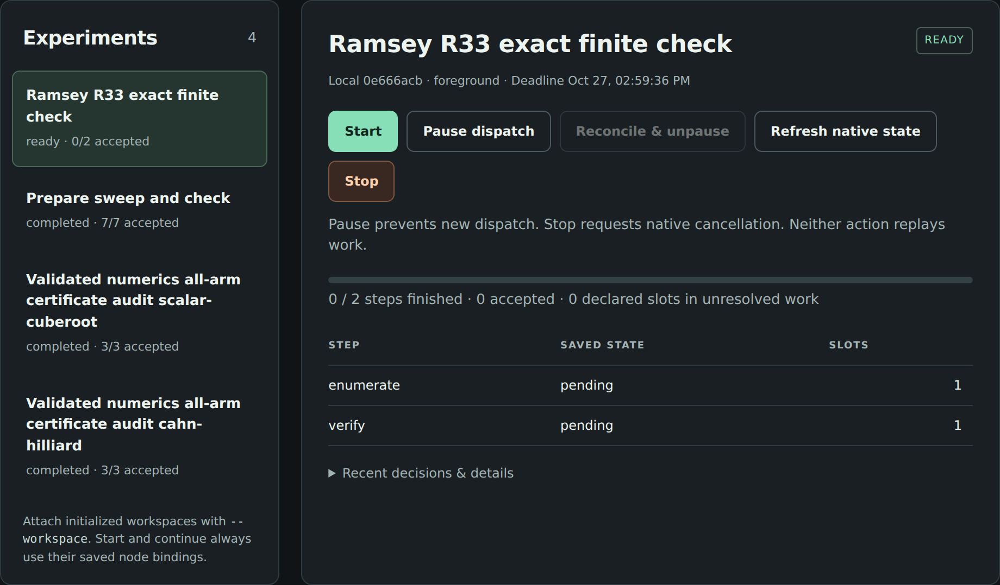
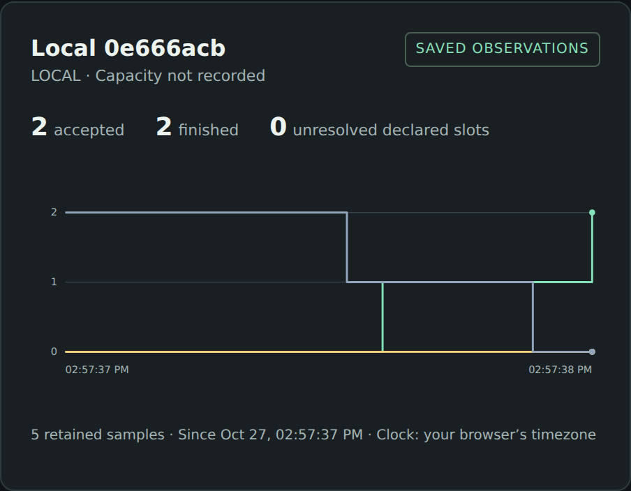
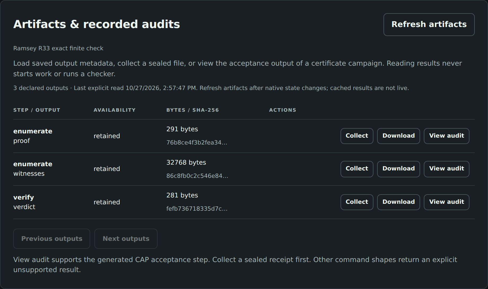

# What this guide lets you do

Use this software to turn a mathematical question into a reproducible
computation: formulate an experiment, search for candidates, run a checker,
and retain the evidence and failures. An AI agent can write and operate the
experiment, but the mathematical claim must come from a stated argument or
checker with explicit assumptions.

This guide covers the source revisions inspected on 27 October 2026. The
central checkout is experiment-craft `63235813cbd2`, including the reviewed
dashboard and recorded certificate views. The native revisions are frozen by
`baseline-lock.json`. All demonstrations described here were run locally;
separate physical machines and a physical phone were not tested.

Three useful starting points are:

- **A working mathematical pilot:** tune a proposed approximate inverse, then
  validate and replay a scalar or PDE point certificate.
- **A solver experiment:** compare bounded black-box searches, solve a small
  integer model, or check a smooth constrained first-order point.
- **Your own exact computation:** run a transparent finite checker as trusted
  commands. The Ramsey example below supplies and checks 32,768 witnesses.

## The distinctions to keep

| Observation | What it supports |
| --- | --- |
| Small floating residual or good objective | A numerical candidate worth examining |
| Feasible point, numerical bound/gap, or KKT residual | The native solver's numerical claim under its stated tolerances |
| A successful theorem-specific interval validation and fresh replay | The stated local mathematical conclusion, under the verifier's trusted assumptions |
| A sealed output or a hash match | Identity of bytes, not validity of the mathematics |
| Dashboard `reported_accepted` | The admitted application reports acceptance consistently with its execution record; the dashboard ran no checker |

The strongest claim is not selected by how convincing the picture looks. In
particular, an inconclusive validation is not a proof of nonexistence, and a
small discretized PDE residual does not control an unresolved infinite tail.

# Which repository does what?

| Repository | Mathematical role | Use it when |
| --- | --- | --- |
| [experiment-craft](https://github.com/dietmarwo/experiment-craft) | Campaigns, dependent steps, budgets, immutable inputs, reports and local dashboard | You need a reproducible collection of computations and their evidence |
| [optimization-jobs](https://github.com/dietmarwo/optimization-jobs) | Executes optimization jobs and trusted commands; owns admission, files, handles, cancellation and recovery; supplies CLI/MCP | You or an agent must run and inspect a bounded attempt |
| [fcmaes-rust](https://github.com/dietmarwo/fcmaes-rust) | Native Rust black-box, multi-objective and quality-diversity search; application workers; the validated-numerics tutorial | Your objective lives in Rust, or you use its prepared mathematical applications |
| [fast-cma-es](https://github.com/dietmarwo/fast-cma-es) | Python `fcmaes` with Python/C++ numerical search, parallel retry, Pareto and diversity methods | Your objective is a Python function; run it directly or as a trusted command |
| [LP-IP-craft](https://github.com/dietmarwo/LP-IP-craft) | Linear and mixed-integer linear models in Rust, with Python bindings and a worker | The objective and rows are linear; some variables may be integer |
| [SQP-craft](https://github.com/dietmarwo/SQP-craft) | Smooth constrained nonlinear optimization with derivatives, Python bindings and a worker | A local first-order solution is useful; the current dense pilot supports at most 256 variables |
| [pykep-core-rust](https://github.com/dietmarwo/pykep-core-rust) | Astrodynamics: propagation, Lambert arcs, ephemerides, sensitivities and low-thrust legs | Your mathematical objective is a trajectory model; this supplies physics rather than an optimizer or proof checker |

The two fcmaes repositories are alternative implementations, not a mandatory
pair. The Python `fcmaes` package is not the Rust job worker. The runtime has
no optimizer of its own, and the orchestrator does not replace runtime
supervision or file-transfer verification.

For the CAP pilot, the theorem-specific Julia application is under
the [validated-numerics tutorial](https://github.com/dietmarwo/fcmaes-rust/tree/c5a83e21484892c2c72b4c5c282ae72d1c44b753/tutorials/validated-numerics). Its RadiiPolynomial and
IntervalArithmetic environment is separate from the Rust optimizer core.
This is the source of the rigorous calculations. `experiment-craft` only
coordinates its commands and reads the resulting records.

## Pick an interface

A direct library call is enough for a short interactive calculation. Use a
job when you need a handle, limits, staged inputs and later inspection. Use a
campaign for seed/start sweeps, preparation dependencies or a chain such as
search, audit and acceptance. Use the dashboard to operate an already
initialized campaign and read its saved observations.

Stock workers expose registered mathematical models. They do not accept an
arbitrary new equation merely because an agent writes its name in JSON. For
a new model, implement a supported application worker, use the library in your
program, or stage that program as an explicitly enabled trusted command.

# Application areas and actual coverage

| Area | Available route | Present boundary |
| --- | --- | --- |
| Validated roots and nonlinear steady states | The two fixed CAP applications, fresh verification/replay and all-arm audit | Positive cube root and one order-32 Cahn-Hilliard case only; no general theorem loader |
| Counterexample and extremal search | Black-box optimization of a violation or extremal score, followed by an independent checker | No universal counterexample decoder or proof extraction |
| Finite combinatorics | Trusted enumeration/search/check commands; Ramsey witnesses in this guide | Completeness is the application's responsibility |
| LP, integer selection, allocation and discrete designs | LP-IP-craft with explicit rows, finite MIP bounds and independent model checks | Numerical solver claims; no automatic exact certificate for arbitrary MIPs |
| Smooth inequalities, constrained profiles and parameter fits | SQP-craft or a numerical library with gradient/Jacobian checks and multistart | Local first-order evidence; no global-optimality or nonlinear infeasibility proof |
| Pareto exploration and diverse constructions | fcmaes MODE and MAP-Elites/library diversity tools | A population/archive is not an exhaustive classification or a certified Pareto set |
| Expensive simulation calibration | Experimental Rust surrogate profile, or ordinary search/retry | Surrogate profile: continuous deterministic boxes, up to 32 variables and 256 observations in total, including warm data |
| Dynamics, trajectories and astrodynamics | pykep-core-rust models with fcmaes or smooth optimization | Check units, ephemerides, discretization and model validity separately |
| Fluid models and inverse design | Native simulation tutorials or a custom trusted simulator/checker | The room-ventilation tutorial is an engineering model, not a rigorous Navier-Stokes or Euler proof |

These are different levels of readiness. A method being useful in an area
does not mean a theorem checker for that entire area exists. New singularity
proofs, branch continuation, stability proofs, parameter-region coverage and
semantic replay across environments require additional mathematics and code.

A good custom proof-search design optimizes quantities that make a fixed
verification argument easier: an approximate inverse, a weight, a basis or a
bound allocation. Keep the equation, exact target, admissible function class
and conclusion fixed while comparing methods. Changing them is a new problem,
not an improved result for the old one.

# First setup and a seven-job tour

The supported workflow here uses a Linux source checkout. Use Python 3.12 or
newer, Git, a C/C++ build toolchain and rustup. The native build toolchain is
Rust 1.88.0. Start from experiment-craft's recorded source rather than assuming
that a similarly numbered package release contains every tutorial feature.

Use a checkout containing this guide and its example files (or apply the
accompanying patch as described in `APPLY.md`). For a later source installation:

```bash
git clone https://github.com/dietmarwo/experiment-craft.git
cd experiment-craft
# Use the revision recorded in the accompanying source snapshot.
python3.12 -m venv .venv
.venv/bin/python -m pip install -r requirements-baseline.txt
.venv/bin/python -m pip install -e .
rustup toolchain install 1.88.0 --profile minimal
.venv/bin/python scripts/baseline.py fetch build smoke \
  --workspace .baseline --jobs 2
```

`fetch` obtains and verifies the four exact native source revisions and their
shared API compatibility. `build` stages the runner and three workers;
`smoke` runs real jobs. The baseline's `bin/manifest.json` records binary
hashes. Later, `verify` checks the sources; `smoke` also checks the staged
binary hashes. Building can take several minutes and needs network access.

Run the existing tour with a fresh output directory:

```bash
.venv/bin/python examples/campaigns/local-mixed/run.py \
  --bin-dir .baseline/bin --output "$PWD/guide-runs/mixed"
```

It explicitly creates a one-slot local node, registers the three workers,
stages an LP model, runs a three-seed search, solves the LP/IP and SQP models,
and checks their known answers. Seven native jobs should complete. This is
setup by an example program, not automatic node administration by the client.

The LP/IP example is exactly

$$
\min\;5+2x_1+3x_2,\qquad x_1+x_2=1,
\qquad x_1,x_2\in\{0,1\}.
$$

The optimum is 7 at $(1,0)$, checked separately from the solver's
`numerical_optimum` status. The smooth example minimizes

$$
\sum_{i=1}^{4}x_i^2,\qquad \sum_{i=1}^{4}x_i=1,
\qquad 0\le x_i\le1.
$$

Its known answer is $x_i=1/4$ and objective $1/4$. The worker reports
`first_order`; the elementary global argument for this special model is not
a new global guarantee supplied by SQP. Both examples are small plumbing
checks, not performance comparisons with mature solvers.

# Worked CAP example: a positive cube root

The problem is the fixed equation

$$
F(u)=u^3-2=0,\qquad u>0,\qquad
\varepsilon=\frac{1}{10^{10}}.
$$

The coefficient is an exact rational and the physical error target is exact.
Candidate coefficients and approximate inverse entries are saved as lossless
binary64 bit patterns. Keep those original bytes; rounding a printed value
creates a different candidate.
The floating approximation is a proposed centre $\bar u$, not an interval
proof. A candidate also supplies a proposed scalar inverse $A\ne0$.

## What optimization changes

The reference coefficients come from a floating Newton solve. The search
changes a multiplier on the approximate inverse within $[0.5,1.5]$. It does
not optimize the equation, accuracy target or theorem. The frozen protocol has
nine arms: reference, grid, local pattern search, and random/CMA-ES/BiteOpt
with seeds 17 and 29.

There are at most 25 search calls per non-reference arm; the reference uses
one. Including nine winner rechecks and one warm-up gives 211 floating
estimates per study. The score estimates a verification safety margin, not
wall-clock time. A favorable score is only a proposal for the rigorous step.

For intuition, the fixed-point map is $T(u)=u-AF(u)$. On a proposed positive
ball of radius $r$, the verifier rigorously bounds the residual and derivative
by $Y$ and $Z_1$. Its scalar conditions include

$$
Y+(Z_1-1)r\le0,\qquad Z_1<1,\qquad
0<r\le\varepsilon.
$$

Together with the stated whole-ball, injectivity and branch checks, they
support existence and uniqueness in that ball. The complete contract is
[THEOREM.md](https://github.com/dietmarwo/fcmaes-rust/blob/c5a83e21484892c2c72b4c5c282ae72d1c44b753/tutorials/validated-numerics/THEOREM.md).
The software does not claim a maximal uniqueness radius.

## Prepare the Julia and search environments

Use **Julia 1.10.10**. Set `GUIDE_JULIA` below to its absolute executable;
it is an explicit installation choice. Do not run `Pkg.update()` when
reproducing this study. From experiment-craft's root:

```bash
export GUIDE_JULIA=/absolute/julia-1.10.10/bin/julia
export GUIDE_APP="$PWD/.baseline/repos/fcmaes-rust/tutorials/validated-numerics"
export JULIA_DEPOT_PATH="$PWD/guide-julia-depot"
export JULIA_NUM_THREADS=1 OPENBLAS_NUM_THREADS=1
export OMP_NUM_THREADS=1 MKL_NUM_THREADS=1
export JULIA_PKG_USE_CLI_GIT=true
"$GUIDE_JULIA" --startup-file=no --project="$GUIDE_APP/julia" \
  -e 'using Pkg; Pkg.instantiate()'
cargo +1.88.0 build --release --locked \
  --manifest-path "$GUIDE_APP/search/Cargo.toml" \
  --target-dir "$PWD/guide-search-target"
```

The Julia project/manifest pins RadiiPolynomial 0.11.10 and
IntervalArithmetic 1.0.12, including their source identities and dependencies.
The instantiated depot and interpreter must exist on the node; the job does
not transfer their installations. Keep that trusted environment controlled.

## Run, inspect and retain

```bash
.venv/bin/python examples/campaigns/certificates/run.py \
  --fcmaes-source .baseline/repos/fcmaes-rust \
  --binary guide-search-target/release/cap-search \
  --julia "$GUIDE_JULIA" --depot "$JULIA_DEPOT_PATH" \
  --runner .baseline/bin/optimization-run \
  --problem scalar-cuberoot --output "$PWD/guide-runs/scalar"
```

This wrapper explicitly creates its own node. It runs three admitted jobs:
search, an audit that verifies/replays every final arm, and strict acceptance.
For one study the audit starts 18 fresh Julia processes, serialized inside its
one-slot attempt. It retains the receipt, writes an offline report, performs
nine separate exact-rational bound checks and confirms that continuation adds
no jobs. Use new directories for a new scientific attempt.

The fresh guide run reported 9/9 arms accepted. This is evidence that these
easy candidates validate, not evidence that one optimizer is better. The
report is `verification/verification.json` inside `guide-runs/scalar/`;
the workspace is `guide-runs/scalar/campaign`.

For manual collection and offline reporting:

```bash
.venv/bin/experiment-craft artifacts \
  --workspace guide-runs/scalar/campaign
.venv/bin/experiment-craft collect-artifact \
  --workspace guide-runs/scalar/campaign \
  --step accept --output acceptance
.venv/bin/experiment-craft verification-report \
  --workspace guide-runs/scalar/campaign --step accept \
  --destination "$PWD/guide-runs/scalar-report"
```

The report destination is outside the campaign and native node. Repeated
collection checks a retained copy offline; repeated reporting runs no checker
and starts no new job. Fresh scientific replay is a new explicit computation,
not a call to `continue`.

# Worked PDE example: a Neumann steady state

The second fixed problem is

$$
\begin{aligned}
u''+\beta(u-u^3-c)&=0 &&\text{on }[0,1],\\
u'(0)=u'(1)&=0,&\quad c&=0,\quad\beta=\frac{1285}{32}.
\end{aligned}
$$

The verifier works in the real, even, 2-periodic function space, with

$$
u(x)=a_0+2\sum_{k\ge1}a_k\cos(k\pi x),\qquad
\|a\|_X=|a_0|+2\sum_{k\ge1}|a_k|.
$$

Here the factor two is essential. Since
$\|u\|_\infty\le\|a\|_X$, an accepted coefficient-norm radius
$r\le10^{-10}$ controls the same physical sup-norm error. The first cosine
mode is certified positive, proving the solution is nonconstant and fixing its
sign orientation. Uniqueness is local in this stated even function space.
There is no stability or full-branch conclusion.

The saved approximation has modes through $K=32$ and a finite approximate
inverse. The verifier extends the inverse by an inverse-Laplacian tail and
checks both the finite and analytic infinite-tail defects. A representative
tail bound is

$$
Z_{1,\mathrm{tail}}=
\frac{\beta\bigl(1+3\|\bar u\|_X^2\bigr)}{[\pi(K+2)]^2}.
$$

The second-order conditions include

$$
\begin{aligned}
Y+(Z_1-1)r+\tfrac12 Z_2r^2&\le0,\\
Z_1+Z_2r&<1,\qquad 0<r\le10^{-10}.
\end{aligned}
$$

These formulas summarize this particular verified argument; they are not a
universal theorem obtained by substituting arbitrary residuals. The adapter
also checks inverse injectivity, arithmetic guarantees and the full function-
space/tail hypotheses. Read the mathematical contract before extending it.

Search tunes two inverse-row multipliers in $[0.5,1.5]^2$: one for the zero
mode and one shared by nonzero rows. The reference coefficient vector, order,
exact target and tail stay fixed. To run this example, repeat the certificate
command above with `--problem cahn-hilliard` and output
`"$PWD/guide-runs/pde"`. The fresh guide run reported 9/9 accepted arms with
nine independent rational checks. It is a reproduction of a known reference
validation, not a new PDE theorem or a blowup construction.

# Worked finite example: Ramsey witnesses

This guide adds a small exact application under
`examples/mathematicians/ramsey/`. It checks the known statement

$$
R(3,3)=6.
$$

Here $R(3,3)$ is the least number of vertices forcing a triangle or an
independent triple in every simple graph. Every labelled simple graph on six
vertices has 15 possible edges, hence
$2^{15}=32{,}768$ edge masks. The producer supplies one monochromatic triple
for every mask. A triple with all three edges present is a triangle; all three
absent is an independent triple. The checker reads exactly one witness per
mask and checks its three edge bits using a separately coded index formula.
It also checks that the five-cycle has neither kind of triple, establishing
the lower example. Thus coverage is explicit rather than inferred from random
sampling or from an optimizer finding nothing.

```bash
.venv/bin/python examples/mathematicians/ramsey/run.py \
  --runner .baseline/bin/optimization-run \
  --output "$PWD/guide-runs/ramsey"
```

Two trusted command jobs execute: `enumerate` and `verify`. Required sealed
outputs bind `proof.json` and the 32,768-byte witness file into the checker;
its `verdict.json` records the checked conclusion. The demo confirms two jobs,
complete coverage and no duplicate execution on continuation. It needs only
Python and the runtime, not a solver or Julia. `--prepare-only` initializes the
campaign without submitting jobs, for starting it through the dashboard.

This finite result trusts the explicit enumeration, checker, Python integer
semantics and execution environment. It is not a proof-assistant certificate.
Its application-specific verdict is available through artifacts; the built-in
CAP audit view intentionally rejects this different campaign shape. A general
mathematical application does not automatically acquire a domain adapter.

# Operate experiments through the dashboard

Attach existing workspaces after initialization. For example:

```bash
.venv/bin/experiment-craft dashboard \
  --workspace "$PWD/guide-runs/scalar/campaign" \
  --workspace "$PWD/guide-runs/pde/campaign" \
  --workspace "$PWD/guide-runs/ramsey/campaign" \
  --state-dir "$PWD/guide-dashboard-history"
```

Open the printed temporary-token URL on the coordinator. The service binds
only to `127.0.0.1`; there is no public hosting or LAN flag. A physical phone
needs a separately secured access path, which is not installed by this guide.
The token is removed from the address bar after it enters tab storage. Do not
publish a token or an active token URL in a screenshot.

## Read the screen in two layers

Start/Continue advances existing work. Pause prevents further dispatch after
an already committed attempt; Stop requests native cancellation and its
outcome must still be observed. Reconcile & unpause verifies original handles
and does not itself start pending work. Unknown attempts are observed, never
automatically replayed. A dashboard restart starts no work on its own.

Node charts show sampled saved step counts and observation times. They do
not show CPU/RAM/GPU utilization, solver convergence, within-job percentage,
ETA or exact historical execution. Multiple local node roots on one computer
remain one physical machine. An accepted step passed its declared execution
policy; that alone is not a mathematical theorem.

Use **Load artifacts**, then **Collect** a sealed output and **Download** a
checked retained file. For a generated CAP campaign, select the acceptance
step's `acceptance` output and press **View audit**. JSON, Markdown and CSV
report downloads match the CLI renderer. Every arm stays visible, with its
verification/replay outcome, censoring and accounted cost.

Collection follows the advancement lane and is disabled when advancement
observations are stale/failed or progress history is unavailable. During a
collection, audit reads/downloads wait. Pause/Stop have a separate control
lane. Catalog and audit reads are explicit, not repeated on every status poll.
After a restarted dashboard stops reporting an operation, refresh artifacts
to inspect its actual retained result.

| Report status | Read it as |
| --- | --- |
| `reported_accepted` | The application's bound receipt says accepted and its native exit/state supports that report |
| `reported_rejected` | The application reports rejection under its documented exit convention; inspect every arm |
| `unconfirmed` | A receipt exists, but its native execution/exit does not support the scientific report |
| `unavailable` | No terminal receipt is recorded; counts/costs remain unknown |

`verification-report` validates an admitted application's records. It does
not rerun Julia, prove the theorem, or independently trust an external
certificate. For untrusted incoming proof data, run the trusted checker and
fresh replay before relying on the result. Hashes are not signatures.

The screenshots at the end show real runs of this guide, including an actual
scalar audit. They use inspected source, not generated UI mockups or
fixture-copying acceptance jobs.

# Prompting agents effectively

Give the agent a mathematical problem card and a precise operational scope.
Tell it which evidence would count as success. Ask for immutable problem
inputs, a small deterministic test, explicit budgets and a reproducible
handover. Keep the evaluator and optimizer together inside one program;
do not send one remote/model request per objective evaluation.

## A reusable problem card

```text
Question and exact intended conclusion:
Domain, variables, units and representation:
Objective(s), constraints and feasibility convention:
Available derivatives or evaluation code:
Exact constants and physical accuracy target:
What is allowed to vary, and what must stay frozen:
Candidate checker / theorem assumptions:
Evaluation, wall-time, core and memory budgets:
Seeds/starts, baseline and held-out cases:
Required artifacts and independent recheck:
```

Bounds must be mathematically justified, not arbitrary placeholders. For
structured variables, define encoding and repair. A failed simulation needs
an explicit outcome; do not turn it into a favorable objective.

## Prompt 1: reproduce and inspect the existing CAP pilot

```text
Use the checked experiment-craft checkout and its baseline-lock.json.
Read AGENTS.md, docs/verification-reports.md and the fcmaes-rust
validated-numerics README, THEOREM, SEARCH and AUDIT guides.

Reproduce scalar-cuberoot with the pinned Julia environment on a
fresh one-slot local foreground node. Keep its exact equation,
physical target 1/10000000000, theorem, coefficient construction,
search protocol and verification/replay budgets unchanged.
Run all nine final candidates through fresh verification/replay.
Collect the bound acceptance receipt and produce JSON/CSV/Markdown.
Check the rational bounds separately as the example does.

Report every arm and every failure. Distinguish floating score,
rigorous outcome, native execution and dashboard-reported verdict.
Confirm continuation creates no extra jobs. Return source/binary
hashes, commands, evidence, limitations and an implementation log.
Do not infer optimizer superiority or regional coverage.
```

## Prompt 2: investigate a new conjecture or proof-parameter search

```text
First write the problem card for the attached conjecture. Identify
whether the task is candidate search, counterexample search, exact
finite verification, or a theorem-specific interval argument.
Read the shared optimization-jobs ai-context.md and the chosen
solver/application guide. Discover the real model/API before coding.

Build a small independent checker before a long search. Proposals
may be floating point; a claimed counterexample must be checked in
the specified exact or rigorously bounded representation. If the
existing CAP loader does not support this problem, say so and add
an explicit application adapter rather than changing a frozen pilot.

Use a short bounded exploratory campaign and a fixed baseline.
Keep mathematical constants, assumptions and success criteria
separate from tunable search settings. Retain failed/uncertain runs.
A search with no counterexample is not a proof. Return reproducible
inputs, all outputs, checker results and precisely scoped conclusions.
```

## Prompt 3: choose LP/MIP or SQP from the formulation

```text
Preserve the required mathematical evidence when choosing a solver.
For a linear model, read LP-IP-craft's ai-context.md, declare all
rows/senses/variable kinds, ensure finite MIP bounds, and independently
check objective, row residuals, integrality and any bound/gap report.

For a smooth nonlinear model, read SQP-craft's ai-context.md. Check
the 256-variable limit, supply and test gradient/Jacobian conventions,
use declared starts, and retain primal/KKT residuals and termination.
A first-order point is not global optimality or a proof of infeasibility.

Start with a known small instance, then a fresh campaign with stated
limits. Use the native numerical claim verbatim. Any exact theorem
claim needs a separate appropriate checker and stated assumptions.
```

## Prompt 4: review evidence independently

```text
Review the frozen mathematical statement, domain, norm, exact
constants, theorem hypotheses, decoder, checker and budget policy.
Treat candidate files as untrusted data. Verify their subject and
input links; rerun the trusted verifier/replay for external proof data.
Check unresolved modes or complete finite coverage, as appropriate.

Try wrong branches, corrupted witnesses, missing/altered tails,
changed inputs, partial ledgers and unsuccessful native executions.
Keep inconclusive, rejected, unavailable and unconfirmed distinct.
Do not edit a bound, flag or target to make an attempt pass.
Return the strongest supported conclusion and an explicit list of
trusted components and remaining mathematical/operational gaps.
```

## If the agent uses MCP

`optimization-mcp` is the runtime interface, not a separate theorem prover.
Ask the agent to start with `get_guide`, `describe_node` and
`describe_worker`; discover actual schemas and supported models before
forming a job. Its normal sequence is `put_input`, `validate_job`,
`submit_job`, then `wait_job`/`get_job` and `get_result`/`get_artifact`.
Use the recorded handle after uncertainty. `put_input` is data storage, not
code deployment. A new executable/model needs explicit local setup, a library
program or the trusted-command route. Campaign composition and the dashboard
remain the experiment-craft CLI's job; do not invent a campaign MCP tool.

These are prompt templates, not claims that an unattended model has proved a
new theorem. The commands and examples in this guide were exercised directly;
no separate model-provider evaluation is implied.

# Compare methods without changing the question

For ordinary solver studies, experiment-craft supports a protocol declared
before dispatch. It fixes groups, allowed variation, seeds/starts, metrics and
work/time caps. Use `dry-run`, `init`, `declare-comparison`, `continue`, then
`compare`; the [comparison guide](https://github.com/dietmarwo/experiment-craft/blob/63235813cbd2906d01792f39d484e0c138717804/docs/scientific-comparisons.md) gives schemas and
a tested 17-job example. All planned observations remain in the denominator.
Some of that example's failures are deliberate and its expected campaign
status is `incomplete`.

A complete feasible cohort and an available feasible point are different.
Unknown work is not zero work. Means/medians are descriptive; the client does
not generate a ranking, p-value, confidence interval or optimality theorem.
Declared slots and slot-seconds are admission reservations, not measured CPU
use. Fixed work and fixed time answer different questions.

CAP audits currently report final-candidate costs: shared search startup, arm
search and fresh verification/replay under the application's accounting.
They do not certify intermediate search proposals or measure time to the
first certificate found. Failed arms can be informatively censored. There is
no successful-only median, survival estimate or proof-aware comparative cohort
adapter. Harder/held-out problems, more repetitions and a predeclared anytime
certification policy remain future scientific work.

# Handover, recovery and publication

Keep the frozen mathematical specification, source commits, binary/environment
identities, actual candidates, verification/replay records, search/audit
protocols, ledgers and checked result files. The campaign retains admitted
input snapshots; a report is a convenient view, not a substitute for the
workspace and the proof data.

Use maintenance pause and the documented backup/paused-restore operations.
Copying only an active SQLite main file can omit its WAL. Maintain one writable
campaign authority. An unknown start is reconciled through its original
native handle, not rerun because a terminal or agent disconnected.

The useful claim in a paper is specific: what equation/domain/norm was checked,
what complete finite set was covered, which assumptions and implementation were
trusted, which exact evidence identifies the result, and which failures were
retained. A screenshot illustrates operation; machine-readable evidence and a
reproducible checker support the scientific statement.

RT-07/RT-08 resource/backend commissioning and automatic placement remain open.
The runtime has explicit remote capabilities, but this Python campaign client
does not route its campaigns to SSH workers. A prepared inventory with six
disabled workers is not a six-machine validation. Independently commissioned
hosts, secured phone access, GPU/resource isolation and portable semantic
replay require separate evidence.

# Sources and version boundary

| Inspected source | Revision |
| --- | --- |
| experiment-craft | `63235813cbd2` |
| optimization-jobs | `051435c325a5` |
| fcmaes-rust | `c5a83e214848` |
| LP-IP-craft | `e5cf5d04322a` |
| SQP-craft | `687b78e22d41` |
| fast-cma-es (optional Python route) | `3ba89a731416` |
| pykep-core-rust (optional physics library) | `542158b575ad` |

Full revisions, URLs and source hashes are in
[the source snapshot](mathematicians/sources.json). The optional Python and
astrodynamics libraries are documented from their inspected sources; they are
not added to the orchestrator's locked native baseline by this guide.

Read next:

- [Shared solver and agent guide](https://github.com/dietmarwo/optimization-jobs/blob/051435c325a51cc89be4ae26645d6937eed6f5e5/ai-context.md): interfaces, modelling, native evidence and limits.
- [CAP mathematical contract](https://github.com/dietmarwo/fcmaes-rust/blob/c5a83e21484892c2c72b4c5c282ae72d1c44b753/tutorials/validated-numerics/THEOREM.md), [bounded search](https://github.com/dietmarwo/fcmaes-rust/blob/c5a83e21484892c2c72b4c5c282ae72d1c44b753/tutorials/validated-numerics/SEARCH.md) and [all-arm audit](https://github.com/dietmarwo/fcmaes-rust/blob/c5a83e21484892c2c72b4c5c282ae72d1c44b753/tutorials/validated-numerics/AUDIT.md).
- [Artifacts and report semantics](https://github.com/dietmarwo/experiment-craft/blob/63235813cbd2906d01792f39d484e0c138717804/docs/verification-reports.md), [dashboard reference](https://github.com/dietmarwo/experiment-craft/blob/63235813cbd2906d01792f39d484e0c138717804/docs/dashboard.md) and [illustrated operator manual](https://github.com/dietmarwo/experiment-craft/blob/63235813cbd2906d01792f39d484e0c138717804/docs/ui-user-manual.md).
- [LP/IP agent guide](https://github.com/dietmarwo/LP-IP-craft/blob/e5cf5d04322a0ddecfb364b392ef92288bd27ee2/ai-context.md) and [SQP agent guide](https://github.com/dietmarwo/SQP-craft/blob/687b78e22d41e3843226398191c8c62c0246a998/ai-context.md).
- [Prompt-driven application tutorials](https://github.com/dietmarwo/optimization-jobs/tree/051435c325a51cc89be4ae26645d6937eed6f5e5/tutorials/agentic), [CFD prompt workshop](https://github.com/dietmarwo/fcmaes-rust/tree/c5a83e21484892c2c72b4c5c282ae72d1c44b753/tutorials/cfd-room-ventilation/agentic) and [astrodynamics scope](https://github.com/dietmarwo/pykep-core-rust/blob/542158b575ad9d235841d501772c179177d69660/README.md).

The PDE/reference formulas follow the pinned RadiiPolynomial examples credited
in the application's `RADII_POLYNOMIAL_LICENSE.txt`; no new attribution or
independent theorem implementation is claimed by this handbook.

# Screenshots of actual guide runs

The following images were captured from the checked dashboard with real local
jobs. The scalar/PDE campaigns ran the genuine verifier and replay; their
receipts were not copied from test fixtures. Images omit the address bar and
access token. The PDF places the wide views on landscape pages for legibility.









