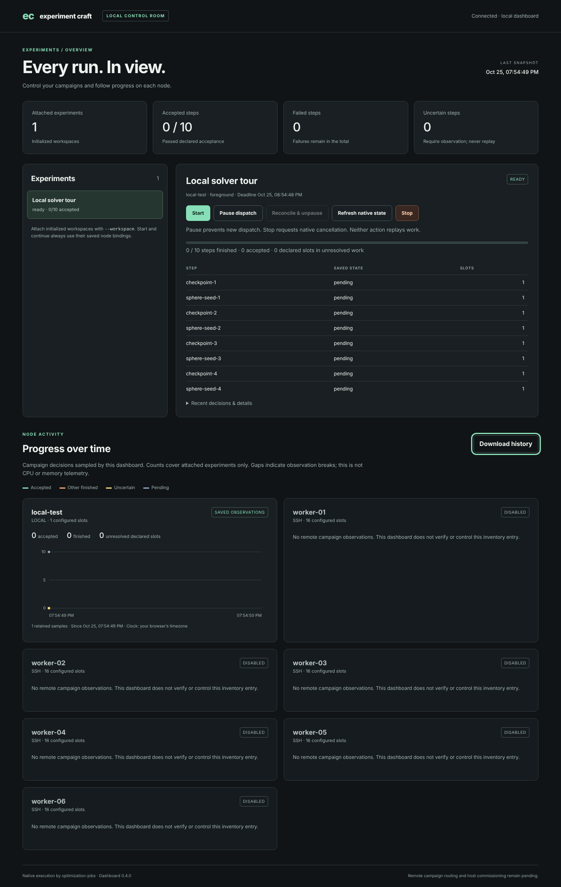
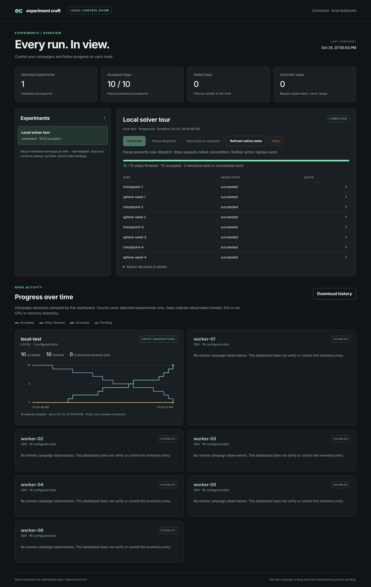
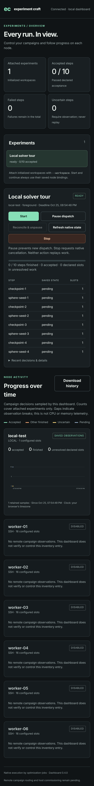

# Experiment Craft UI user manual

For the local browser dashboard in **experiment-craft 0.4.0**. Use it to start
and inspect initialized experiments, pause dispatch, request cancellation, and
follow step counts over time on each node.

An **experiment** in the UI is a campaign workspace: one saved run of a manifest,
its steps, its original node binding and its results. Prepare that workspace
with the CLI, then attach it to the dashboard. The browser does not create or
edit experiments yet.

The screenshots below are real Chromium captures retained with the merged
review. They show the ten-step **Local solver tour** on one local test node and
six disabled planned workers. They are example observations, not your machines'
current state. See [Screenshot sources](#screenshot-sources).

## Contents

- [First launch](#first-launch)
- [Open an existing experiment](#open-an-existing-experiment)
- [Find your way around](#find-your-way-around)
- [Start, pause, resume and stop](#start-pause-resume-and-stop)
- [Read progress and node charts](#read-progress-and-node-charts)
- [Save history and results](#save-history-and-results)
- [Close and reopen safely](#close-and-reopen-safely)
- [Use several experiments and the node inventory](#use-several-experiments-and-the-node-inventory)
- [Use the narrow-screen layout](#use-the-narrow-screen-layout)
- [Troubleshooting](#troubleshooting)
- [Command options](#command-options)
- [Screenshot sources](#screenshot-sources)

## First launch

### Install the client

Use Linux and Python 3.12 or later. Version 0.4.0 is currently unpublished, so
install from the checked-out repository or a reviewed wheel. From the repository:

```bash
python3 -m venv .venv
.venv/bin/python -m pip install -e .
.venv/bin/experiment-craft --version
```

The version should be `0.4.0`. Keep this terminal in the repository directory
for the examples below. No Node, frontend build or internet chart service is
needed to use the UI.

Execution also needs the pinned `optimization-run` and the registered workers.
If you have no checked native installation yet, follow the
[Linux requirements and build instructions](../README.md#reproduce-on-linux).
After installing the listed Rust toolchains and system tools, these commands
build and smoke-test the native set in a new workspace:

```bash
.venv/bin/python -m pip install -r requirements-baseline.txt
.venv/bin/python scripts/baseline.py fetch build smoke --workspace .baseline --jobs 2
```

Retain those exact binaries while campaigns are bound to them. Campaigns check
the saved runner, worker and node identities when you continue them.

### Try the prepared example

Choose a new output directory that does not exist:

```bash
.venv/bin/python examples/dashboard/prepare.py \
  --bin-dir .baseline/bin \
  --output /absolute/new/ui-demo-01 \
  --serve
```

Replace `/absolute/new/ui-demo-01` with your chosen absolute path. If your
checked native binaries are elsewhere, replace `.baseline/bin` too. The script
creates a fresh one-slot local test node, registers the three workers, and
initializes ten dependent steps. Four visible two-second checkpoint commands
give you a moment to try Pause or Stop while a step runs; the other steps run
four seeded sphere optimizations, an LP/IP solve and an SQP solve. The whole
tour takes about a quarter of a minute once started.

The tour's campaign deadline is one hour after preparation. Started later, it
stops every pending step at once (`deadline_exceeded`); prepare a new demo
instead. The example samples every half second, not every two seconds. If the
port is in use, the script prepares the demo, prints `port_unavailable` and
exits 2: reopen the demo with the
[reopen command](#close-and-reopen-safely) and another `--port`. An existing
output directory gives `output_exists`.

1. Wait for a JSON line with `"status":"dashboard_listening"`.
2. Open its complete `url` in a browser **on the same computer**. The default
   address begins `http://127.0.0.1:8765/` and includes a temporary token.
3. Confirm that the top right says **Connected · local dashboard** and that
   **Local solver tour** is selected.
4. Check that the experiment is **READY**, with `0 / 10` accepted steps.
5. Press **Start** when you want to execute it, within the hour. Preparing and
   opening it submits no jobs.



*Figure 1. The prepared experiment before Start. The step table scrolls inside
its panel; eight rows are visible in this capture, but the experiment has ten
steps. The six disabled worker cards are inventory entries.*

The token moves into that tab's session storage and disappears from the address
bar. Refreshing the same tab preserves access. Keep the printed URL private;
it authorizes the controls while this server process lives, and the browser may
retain it in its visited-page history. A server restart creates a new token:
open the newly printed URL in the same tab or a new one.

## Open an existing experiment

For a campaign that has already been initialized, start the UI directly:

```bash
.venv/bin/experiment-craft dashboard \
  --workspace /absolute/campaign \
  --state-dir /absolute/dashboard-history
```

`--workspace` identifies the campaign directory, not the manifest JSON or the
native node root. `--state-dir` is a separate directory for chart observations.
It must be outside, and must not contain, any attached campaign or native root;
the same separation applies to coordinator and local roots in an inventory.
Only one dashboard can use that history directory at a time.

If you have only a manifest, initialize it first against an already configured
node. For example, with explicit local foreground execution:

```bash
.venv/bin/experiment-craft dry-run /absolute/source/campaign.json
.venv/bin/experiment-craft init /absolute/source/campaign.json \
  --workspace /absolute/new/campaign \
  --runner /absolute/native/bin/optimization-run \
  --node-root /absolute/node \
  --mode foreground
```

Declare any scientific comparison before the first dispatch. The
[campaign guide](campaigns.md) and [comparison guide](scientific-comparisons.md)
cover manifests, trusted command policy, worker registration requirements and
comparison declaration. A dashboard launch never initializes or rebinds a node.

## Find your way around

| Area | What to read or do |
|---|---|
| Connection indicator | Shows the browser's connection to this dashboard. It does not establish node reachability. |
| Last snapshot | Time of the latest saved-state observation, in your browser's timezone. Hidden on screens 500 px wide or less. |
| Four summary cards | Counts across all attached experiments: experiments, accepted steps, failed steps and uncertain steps. |
| Experiments list | Select the experiment whose controls and step details you want to use. |
| Experiment heading | Check the selected name, status badge, node label, execution mode and original deadline before acting. Between steps of a run the badge can show READY as well as RUNNING. |
| Controls | Start/Continue, Pause dispatch, Reconcile & unpause, Refresh native state and Stop affect the selected experiment. |
| Step table | Read each step's saved state and requested CPU slots. Scroll within the table to reach the remaining rows; the position is kept while the page refreshes. |
| Recent decisions & details | Expand to inspect the workspace path, IDs, maintenance record, recent events and step errors. It stays open while the page refreshes. |
| Progress over time | Inspect one card per node; these aggregate the attached campaigns bound to that node. |
| Download history | Save the currently loaded chart samples as JSON. |

The **Failed steps** card counts `failed` only. Cancelled, blocked, stopped and
budget-exhausted steps still count as finished in the detail panel and in the
charts' **Other finished** series. Therefore, zero failures alone does not mean
that every step was accepted.

## Start, pause, resume and stop

### Start or continue execution

Select the experiment and press **Start**. Once any step has been issued, this
button is labeled **Continue**. The dashboard advances through ready steps
sequentially within that campaign, using its saved plan, budgets and node.

Watch the step states and the accepted count. A control request can be accepted
before the operation finishes. While an operation runs, a line such as
`continue: in progress…` names it by its action: `continue` (Start/Continue),
`pause`, `unpause` (Reconcile & unpause), `collect` (Refresh native state) or
`stop`. Wait for the resulting state rather than repeatedly clicking.
On completion, the demo should show **COMPLETED**, `10 / 10 steps finished` and
`10 accepted`.

### Pause and resume without cancelling the current job

1. Press **Pause dispatch** on the selected experiment.
2. Look for the **PAUSED** badge; the experiments list shows **Dispatch
   paused**. A step whose launch was already committed can still start or
   finish; the advancing operation ends after that step, without an error.
3. Inspect its results or perform maintenance. The original absolute campaign
   deadline keeps running while paused.
4. Press **Reconcile & unpause** when ready. This verifies the saved runtime,
   workers and issued handles. It leaves dispatch paused if the evidence cannot
   be reconciled.
5. After unpausing succeeds, press **Start** or **Continue** separately.

Unpausing does not launch pending steps. Pause applies to cooperating campaign
clients; independent native CLI submissions and older clients can bypass it.
Use one active campaign authority during maintenance.

### Stop an experiment

1. Press **Stop** for the selected experiment.
2. Check the experiment name and workspace path in **Request cancellation?**.
   Workspaces initialized from one manifest share its name; the path tells
   them apart.
3. Choose **Keep running** to dismiss the dialog without requesting stop, or
   **Stop experiment** to commit stop and request native cancellation.
4. Observe the final saved states. Pending steps become `stopped` at once; a
   running step whose native job is observed as cancelled becomes `cancelled`.
   A request acknowledgement alone does not prove termination.

A stopped campaign cannot be reset into a fresh run from the UI. For a deliberate
new experiment, initialize a new workspace; preserve the old evidence.

### Refresh observations

**Refresh native state** collects the existing native handles once without
dispatching new work. Use it after externally driven or detached work has
changed. Normal page refreshes only read saved campaign observations; they do
not continuously probe workers. Wait for an active advancement operation to
finish if collection reports `campaign_busy`.

## Read progress and node charts



*Figure 2. The same real tour after ten completed native jobs. The green line
rises as steps pass their declared acceptance rules. Disabled remote workers
still have no fabricated observations.*

| Chart series | Meaning |
|---|---|
| Accepted, green | Steps in `succeeded`, under the campaign's declared acceptance policy. |
| Other finished, orange | Failed, cancelled, blocked, stopped or budget-exhausted steps. |
| Uncertain, yellow | Steps in `unknown`: execution may exist and must be observed before further decisions. |
| Pending, blue-grey | Steps that have not yet been issued. |

The horizontal axis is observation time; the vertical axis is a **number of
steps**. Active and dispatching steps are not separate chart series. During a
run, the four displayed series therefore need not sum to the total step count.
Likewise, `5 / 10 accepted` does not imply half of the compute time is complete:
steps can have very different costs.

**Unresolved declared slots** adds the requested slots of dispatching, active
and unknown steps. **Configured slots** comes from the optional inventory.
Neither is measured CPU use. This UI has no CPU/RAM/GPU graph, objective-value
trajectory, within-job percentage or ETA. An accepted `best_found` optimization
result retains that claim; the UI does not turn it into a proof of optimality.

History starts when a dashboard first observes the attached campaigns. Sampling
is every two seconds by default; changed values and a heartbeat at least every
30 seconds are retained. Short intermediate states can be missed. Restarts,
clock rollback, unavailable campaign state and sufficiently long observation
gaps break the plotted lines. A gap is missing observation, not zero work.

An **UNKNOWN** experiment needs investigation. Expand **Recent decisions &
details**, retain its identifiers and inspect the saved/native evidence. Use
collection or verified reconciliation as appropriate. Never delete its state
or resubmit it merely to clear the yellow count; the client retains the original
handle to avoid duplicate execution.

## Save history and results

### Export chart data

Press **Download history**. The browser saves `experiment-progress.json`, with an
export time and the currently loaded histories, scopes and points. Wait for a
fresh snapshot and no history warning before downloading. If a history request
failed, some node histories may be absent from that download.

The default cache retains up to 2,000 samples for each scope: a node and the
attached campaigns bound to it. Changing which campaigns are attached on a node
starts a new scope for that node's chart; inactive scopes are pruned at startup.
Nodes whose campaigns did not change keep their series. Export before changing
attachments if you need the older aggregate. Restart with the same `--state-dir`
and attachments to retain the existing series, with a new segment.

### Export experiment results

Charts and scientific reports are separate. Use the CLI for retained results:

```bash
.venv/bin/experiment-craft report \
  --workspace /absolute/campaign \
  --destination /absolute/new/report
```

This writes JSON, CSV and Markdown reports from the saved evidence. For a
campaign with a predeclared comparison, use `compare` instead of `report` to
produce its descriptive comparison. See the [comparison guide](scientific-comparisons.md).

### Back up an experiment

A backup requires paused dispatch; otherwise it fails with
`dispatch_not_paused`. Press **Pause dispatch**, stop other advancing clients,
and wait for the current campaign call to finish. Once every step has
finished, the Pause button is disabled; pause from the command line instead.
Then use the campaign backup command:

```bash
.venv/bin/experiment-craft pause-dispatch --workspace /absolute/campaign --reason backup
.venv/bin/experiment-craft backup \
  --workspace /absolute/campaign \
  --destination /absolute/new/campaign-backup.zip
```

The campaign stays paused afterwards. If it still has pending steps, press
**Reconcile & unpause** before **Continue**.

The chart cache is not a campaign backup, and the campaign archive does not
include the native node root or installed binaries. To preserve chart history
separately, stop its dashboard cleanly and copy the history directory. Follow
the [operating guide](operations.md) for restore and native-root preservation.
Copying only the main file of a live SQLite database can lose WAL state.

## Close and reopen safely

| Action | Result |
|---|---|
| Close the browser tab | The server and an active Start/Continue operation keep running. |
| Press Pause dispatch | Further dispatch pauses; committed work can finish. |
| Press Stop and confirm | Requests campaign stop and native cancellation. |
| Send Ctrl-C in the dashboard terminal, or SIGTERM to its process | Refuses new actions, stops advancement between steps and waits for the current call; the in-flight job is allowed to finish. |
| Restart the dashboard | Reads the existing campaign; starts, resumes, unpauses and cancels nothing automatically. |

To leave a run paused, press **Pause dispatch**, wait for the active step and
operation to settle, then stop the dashboard with Ctrl-C. To cancel instead,
use **Stop** and observe the outcome before closing the server. Terminal logout,
host reboot and durable service operation still need separate commissioning.

Reopen the prepared demo without running its preparation script again:

```bash
.venv/bin/experiment-craft dashboard \
  --workspace /absolute/new/ui-demo-01/campaign \
  --state-dir /absolute/new/ui-demo-01/dashboard \
  --deployment /absolute/new/ui-demo-01/deployment.json
```

Use the **newly printed URL**; add `--port 0` or another port if 8765 is in use.
When it stops, the dashboard command (and the example with `--serve`) prints
`dashboard_stopped` with an empty `checkpoint_errors` list and exits 0.
Checkpoint errors produce exit 1:
read them and keep the entire workspace, including WAL files. Unexpected startup
or command errors use JSON error codes and exit 2. These are process outcomes,
not scientific success indicators.

After a hard kill, reopen the same workspace and inspect it before Continue.
Recovery follows the existing saved-handle rules; an ambiguous launch is never
permission to replay. A recovered backup is the same campaign, so keep the old
copy retired and paused rather than driving both copies.

## Use several experiments and the node inventory

Repeat `--workspace` for 1–32 distinct initialized campaigns:

```bash
.venv/bin/experiment-craft dashboard \
  --workspace /absolute/experiment-a \
  --workspace /absolute/experiment-b \
  --state-dir /absolute/dashboard-history-ab \
  --deployment /absolute/deployment.json
```

Choose experiments in the list to change the detail panel. Their controls act
on the selected campaign; node charts aggregate all attached campaigns bound to
that native node and root. Two copies of the same campaign are refused.
Workspaces initialized from one manifest share its name in the list; the stop
confirmation and **Recent decisions & details** show each one's workspace path.
Adding a workspace requires restarting the server with a new attachment list.

The optional deployment file supplies labels and inventory cards. The supplied
[home-lab template](../examples/deployment/home-lab.json) has one local default
and six disabled SSH workers, proposed at 16 slots and 128 GiB each. Their cards
are planning information. The coordinator/main desktop remains outside the
planned worker pool; the local test node is an explicit test target.

**Disabled** and **routing unavailable** entries cannot be enabled or controlled
from this UI. Even an enabled SSH inventory entry has no Python remote campaign
routing yet. The dashboard can distinguish multiple local native node roots;
physical multi-host execution and automatic placement remain pending. Use the
[deployment guide](deployment.md) and [January checklist](january-commissioning.md)
before commissioning actual workers.

## Use the narrow-screen layout

Below 850 px wide, the experiment list moves above the details and scrolls
sideways when it holds several experiments, and node cards form one column. At
500 px or less, the summary cards use two columns, the controls stretch across
the panel and wrap, and the **Last snapshot** time is hidden. Scroll vertically
to reach the charts and worker inventory; scroll the step table internally to
see all rows. Keyboard users can Tab to controls and use Enter or Space; the
focused control has a visible focus ring.



*Figure 3. Real Chromium at a 390 × 844 touch viewport, captured at 2× pixel
scale. This is a full-page capture, so it includes content below the initial
screen. [Open the full-resolution phone capture](../evidence/ui-01-review/dashboard-browser/phone.png).*

This capture establishes a browser layout at that viewport, not access from a
physical phone. `127.0.0.1` on a phone refers to the phone itself.
Reaching a dashboard on the coordinator requires a separately secured and
commissioned tunnel or proxy; the dashboard provides no phone connection setup,
LAN binding, public hosting or team accounts. A real-device check remains open.

## Troubleshooting

| Symptom or code | Next action |
|---|---|
| Page cannot open | Check that the server is still running, use its printed `127.0.0.1` URL on the same machine, and check the port. |
| `unauthorized`, or a tab loses access after restart | Open the complete newly printed token URL, in that tab or a new one. A bare address or a token from the previous process is insufficient. |
| `port_unavailable` | Stop the server occupying that port, or choose `--port 8766` or `--port 0`; open the newly printed URL. |
| `dashboard_busy` at startup | Another process may own the history directory. Reuse its tab or stop that process first; do not delete a live lock to bypass it. |
| `dashboard_busy` or `dashboard_stopping` during a control | Wait for the busy operation or shutdown to settle. After restart, reopen its URL and inspect state before retrying. |
| `operation_busy` or `campaign_busy` | Wait for the operation already in progress. Check for another dashboard/CLI driver; avoid repeated Start requests. |
| Start/Continue is disabled | Check pause state, terminal completion, a running operation, connection, observer freshness, campaign read errors and history warnings. Unpause successfully, then Continue separately. |
| `dispatch_paused` | The campaign was already paused when advancement was requested. Reconcile & unpause before continuing. |
| Every pending step became `stopped` right after Start | The campaign's deadline had passed (`deadline_exceeded` in the details); the demo's deadline is one hour after preparation. Prepare a new demo or initialize a new workspace. |
| `dispatch_not_paused` from `backup` | Pause dispatch first; for a finished campaign use `experiment-craft pause-dispatch`. |
| Snapshot is stale / Progress history is unavailable | Inspect the warning and server output; check filesystem permissions and free space. Advance controls are disabled. Pause/Stop remain available while the server can read the campaign. |
| Disconnected | Restore the browser/server connection. All controls are disabled until a request succeeds; an operation may still be running. Inspect before repeating it. |
| Saved state unavailable | Check the original workspace and permissions. Displayed details may be retained stale values; affected node counts are unknown until reading succeeds. |
| Many large campaigns repeatedly disconnect | Each refresh includes every step and up to 30 recent decisions per campaign, with an eight-second request timeout. Attach fewer large campaigns. |
| Unknown/uncertain work or binding mismatch | Preserve the workspace, runner/workers, native root and identifiers. Inspect native evidence and the operations guide; do not reset, rebind or replay the campaign. |
| `checkpoint_busy` or other shutdown checkpoint errors | Close external SQLite readers and inspect the reported workspace. Preserve all database/WAL files and resolve the reader or access problem before copying or recovery. |
| `state_regressed` at startup or for a campaign | The workspace's database lacks decisions it recorded, typically a copy made without `campaign.sqlite3-wal`. Keep it unchanged, run `experiment-craft workspace-check` on it, and attach the complete workspace or restore a backup ([copying a workspace](operations.md#copy-and-check-a-workspace)). |
| `output_exists` from the demo preparation | Use a new output directory for a new tour, or reopen the existing campaign with the [reopen command](#close-and-reopen-safely). |
| No remote graph | Disabled/unobserved inventory entries have no campaign history. Python remote routing and node telemetry are still pending. |

For the full behavior and HTTP boundaries, see the [dashboard reference](dashboard.md).
For restoration, identity checks and uncertain work, see the [operating guide](operations.md).

## Command options

Use `.venv/bin/experiment-craft dashboard --help` for the installed interface.

| Option | Default and use |
|---|---|
| `--workspace PATH` | Required, repeatable; 1–32 initialized campaign directories. |
| `--state-dir PATH` | Required; separate chart-history directory, one dashboard at a time. |
| `--deployment FILE` | Optional validated node inventory for labels and planned-worker cards. |
| `--port N` | `8765`; `0` assigns an available port. Bind address remains `127.0.0.1`. |
| `--sample-seconds N` | `2`; permitted range `0.25`–`60`, for saved-state observation. The page itself attempts a refresh every two seconds. |
| `--history-limit N` | `2000`; integer `10`–`10000`, points per scope (a node and its attached campaigns). |

## Screenshot sources

The three images are unmodified files already committed in the merged review's
[browser evidence](../evidence/ui-01-review/README.md). Its
[report](../evidence/ui-01-review/dashboard-browser/report.json) records 18
passing checks, ten real native jobs and clean shutdown using Playwright
Chromium. Desktop viewport: 1366 × 900; touch viewport: 390 × 844 at 2× scale.
Full-page images extend beyond those initial viewport heights. Screenshot
timestamps use the original capture browser's clock/timezone.

They were recorded in review commit `d4fd468bb989f5d001811802a4a56f05d29ac7b9`,
then merged at `c7cff2082cca31792885e5506de91de68ae7eee1`.
[`evidence/ui-manual-01/`](../evidence/ui-manual-01/README.md) records the image
hashes and that the web assets shipped then equal the captured ones.

The manual's review later changed the page in ways these captures do not
show: the details block and the step table keep their state while the page
refreshes, a token URL pasted into an open tab is taken, and the stop
confirmation also shows the workspace path. The rendered check in
[`evidence/ui-manual-review/`](../evidence/ui-manual-review/README.md) ran on the
changed page.

## Artifacts and recorded audits

With an experiment selected, press **Load artifacts** in the **Artifacts &
recorded audits** panel below the experiment details. Refresh native state first if
another client completed the work. **Collect** fetches one sealed output;
**Download** checks and downloads a retained file. The catalog pages through
100 outputs at a time. An unknown byte count is not a zero-byte file.

For a generated certificate campaign, find the acceptance step's `acceptance`
output, collect it, then press its **View audit** button. The panel shows native
step/state/exit code separately from the application's reported verdict, every
arm's verification/replay outcome, censoring and accounted seconds. Missing
results stay unknown; an accepted receipt from a failed execution stays
unconfirmed. Viewing does not run a checker or prove a theorem.

Use **Download JSON**, **Download Markdown** or **Download CSV** to save the
same checked report as the CLI. The normal status refresh does not reload
artifacts or audits; use **Refresh artifacts** for a fresh result view. A changed
cache gives `artifact_changed` and is never repaired automatically. For the
meaning of each verdict and the application's trust boundary, read the
[artifact and verification guide](verification-reports.md), and for control
and refresh details see the [dashboard reference](dashboard.md#artifacts-and-recorded-certificate-audits).

The screenshots above illustrate the earlier control and progress panels.
The artifact controls are described here in text; no physical-phone
commissioning is implied.
